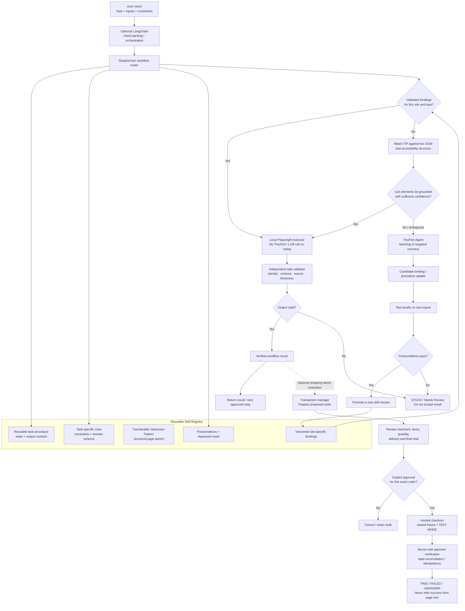

# ShadowTwin - Product Requirements Document

# ShadowTwin - Product Requirements Document

**Status:** Hackathon MVP PRD | **Date:** 21 October 2026 (revised 22 October 2026)

**Product thesis:** ShadowTwin is an enterprise reliability, skill-compilation, and self-healing runtime powered by TinyFish. Running raw LLM agents from scratch on every repeat execution causes compounding errors and high latency; ShadowTwin uses **TinyFish Agent as an autonomous workflow compiler and live self-healing brain**. TinyFish explores live websites, extracts transferable page-structure patterns and site-specific bindings, and dynamically repairs broken workflows when DOM layouts change. Validated skills execute deterministically via Playwright (or TinyFish Fetch/Browser API) with postcondition gates, turning one-off TinyFish explorations into durable, production-grade automation.

**Flagship demo (Hybrid Live-Web + Controlled Self-Healing Fixture):**

1. **Live-Web Induction & Replay:** Use TinyFish Agent to teach product discovery on a real, automation-friendly live e-commerce site (e.g., an Indian electronics store like [Robu.in](http://Robu.in) / MakerBazar or a permitted live storefront), compile the versioned skill, and replay new queries across categories (watch, mobile, electronics components).
2. **Live Cross-Site Transfer:** Transfer the compiled skill to a second structurally distinct live storefront (Store B), using TIP structural matching and TinyFish Agent to ground the new site adapter.
3. **On-Stage Self-Healing (Owned Fixture):** Trigger a live DOM/layout mutation on an owned storefront fixture to break a saved binding on stage, watching TinyFish Agent diagnose the postcondition failure, synthesize binding v2, validate it on two queries, and restore deterministic execution.

<aside>
🧭

**Revision note (23 October 2026 — Swim with TinyFish Alignment).** Architecture and demo flow aligned with hackathon judging criteria:

- **TinyFish as the Central Intelligence:** TinyFish Agent is the core workflow compiler, cross-site adapter generator, and live self-healing engine—not a fallback to be "eliminated." Deterministic replay (local Playwright or TinyFish Fetch/Browser) is framed as the compiled output produced by TinyFish.
- **Live Web First + Owned Fixture for DOM Mutation:** Induction, replay, and cross-site transfer run on permitted **live web** storefronts to satisfy the "browse, search and act on the live web" requirement, while the owned storefront fixture is used specifically to trigger a deterministic on-stage DOM breakage for the self-healing demo.
- A skill has a platform-neutral task template plus separate per-domain bindings.
- The demo covers live-web teach → compiled replay → live cross-site transfer → on-stage DOM breakage & TinyFish Agent self-healing.
- “Stuck” is defined by deterministic postconditions; no silent wrong results are accepted.
- Live-site access respects applicable site terms and robots rules; no bypass of blocks, CAPTCHA or access controls.
- DealMaker policy learning, offer arithmetic and human approval are P1; product lookup and cross-site transfer are P0.

**Sprint Execution Amendment (1 November 2026 — 6-Hour Final Scope Freeze):**
- **Strict P0 Scope Lock:** All P1/P2 items (DealMaker negotiation arithmetic, Razorpay test payment sandbox, multi-tenant credential vaults) are frozen out of the active 6-hour implementation cycle to ensure a flawless working build by the demo deadline.
- **Official TinyFish API Target:** Standardized on official `POST https://agent.tinyfish.ai/v1/automation/run` (and `/run-sse`) with explicit JSON Schema structured outputs, UUIDv4 session tracking, and stealth browser profiles.
- **Pitch-Optimized 3-Act Demo:** The demo focuses exclusively on the 4 key judging beats: (1) Live-Web Induction via TinyFish Agent, (2) Sub-second Replay via local Playwright, (3) Live on-stage DOM Breakage & Autonomous Self-Healing via TinyFish Doctor, and (4) Real Telemetry (Speed, Cost, Zero Silent-Wrong Rate).
</aside>

## Executive summary

ShadowTwin is a TinyFish-powered workflow compiler and self-healing execution layer designed to solve the #1 bottleneck in enterprise web agents: compounding error rates across repeated multi-step runs. Instead of running an unguided LLM from scratch 10,000 times on the same workflow, ShadowTwin uses **TinyFish Agent as a Just-In-Time (JIT) workflow compiler, cross-site adapter generator, and autonomous self-healing engine**. TinyFish explores live websites, induces a versioned skill (separating task logic, transferable structural patterns, and site-specific bindings), and hands validated steps to a deterministic Playwright runner (or TinyFish Fetch) gated by strict postconditions. When a live website changes its layout or a new domain is encountered, TinyFish Agent steps in to adapt and repair the skill automatically.

The six-hour hackathon demonstrates this architecture on the **live web** coupled with a controlled self-healing stage fixture: teaching and transferring product discovery across real, automation-permitted e-commerce storefronts (such as Indian hobby-electronics stores like [Robu.in](http://Robu.in) / MakerBazar or public live test stores) while using a mutable owned storefront fixture specifically to trigger a live DOM layout breakage on stage. Sandbox checkout/payment remains an optional future-facing extension on the owned fixture.

The intended scope is browser-based workflows that can be represented as explicit steps, have observable inputs/outputs, and can be checked through reliable postconditions. The primary proof is live-web workflow compilation, cross-site transfer, deterministic postcondition gating, and autonomous TinyFish-driven self-healing. Live-site consequential write actions (payments/orders) remain out of scope for the hackathon.

## 1. Product overview

### Current architecture (22 October 2026)

**Execution rule:** ShadowTwin's core abstraction is a reusable browser workflow, not a shopping-only skill. The skill registry stores the procedure, task-specific rules, transferable structural patterns, site bindings and tests. Local Playwright runs validated steps; TinyFish Agent is used for teaching or targeted recovery. Shopping is the hackathon's concrete example; sandbox payment is an optional vertical extension, not the platform identity.

### 1.1 Problem statement

People use browser-based systems to perform repetitive multi-step work: search, filter, compare, extract, fill forms, prepare actions and check results. Many websites expose no suitable API, and their user interfaces change over time. Conventional scripts need selectors and maintenance; general-purpose agents can repeat exploration and make inconsistent decisions unless policies are explicit and checked.

Users therefore repeat instructions, re-correct similar outputs and supervise work that is substantially the same from one run to the next.

ShadowTwin aims to turn repeat work into a durable capability:

- Learn the procedure from a few successful Agent runs (and, as P1, explicit human corrections).
- Separate the procedure from personal decision preferences.
- Compile both into versioned, inspectable records.
- Reuse only the parts proven to generalize.
- Retrieve fresh facts and validate every new result.
- Detect failed assumptions, re-explore and maintain version history.

### 1.2 Product statement

**ShadowTwin is a human-supervised hybrid execution and workflow-learning layer for browser agents.** It converts successful browser runs (and, as P1, confirmed user corrections) into versioned skills, then routes each step between deterministic code and TinyFish Agent reasoning according to what is proven, current and safe.

The product ambition is to support reusable skills for browser-based workflows across task domains, provided each workflow can be represented as steps with observable results and testable postconditions. Shopping is the chosen hackathon demonstration because it makes reuse and verification easy to observe: one procedure can be tested across product categories and different storefront layouts. Read-only product discovery is P0. A guarded checkout/payment module is an optional sandbox-only extension, not the platform's core identity; real purchases are out of scope for the hackathon.

Terms used in this document:

- **Template:** the fixed procedure for the task family (section 1.5).
- **Binding:** site-specific handles for a step, such as the search-box locator, the result-card container and the title and price locators.
- **Postcondition:** a deterministic check that must hold after a step.
- **Stuck:** a postcondition failure, timeout, missing element or block page.
- **Induction:** deriving the template and bindings from Agent runs. No model weights change; a procedure and bindings are stored.

### 1.3 Product principles

1. **Model describes; deterministic code decides.** Models may interpret pages or summarize a trace, but price arithmetic, hard constraints, required fields and approval rules are checked deterministically.
2. **Compile only what has been proven.** A successful run does not prove every click or URL is reusable. A candidate skill must pass a test on a new input before becoming active.
3. **Learn from explicit corrections, not guesses.** A user editing one offer may be a one-time exception. ShadowTwin shows the proposed reusable rule and asks the user to confirm it.
4. **Refresh volatile facts.** Navigation knowledge can be reused; current prices, listing content, seller availability and terms must be retrieved again when material to the task.
5. **Fail closed on unsafe or ambiguous actions.** Missing evidence, wrong entities, stale skills or policy conflicts lead to review, not a best-effort action.
6. **Keep humans in control of consequential actions.** The MVP is read-only: it does not log in, add to a cart, send messages, accept deals, make payments or create commitments. Any future outbound action, including DealMaker offers, requires explicit approval.
7. **Measure rather than promise.** Latency, step counts, model tokens where observable and costs must come from real runs. Targets are not results.
8. **Define stuck deterministically.** Every step has a postcondition. A missing element, timeout, block page or failed postcondition is STUCK. A navigator that finishes on the wrong page and returns a wrong price is a worse failure than getting stuck, so postconditions run before any result is accepted.

### 1.4 Hybrid execution model

ShadowTwin is a hybrid system, not an Agent call on every step and not a deterministic script for every task. For each step its router chooses the least complex execution path that is supported, fresh and safe:

1. **Deterministic replay without TinyFish Agent:** a local or team-hosted Playwright runner executes a step using a cached binding for a known domain. For an unseen domain, first match a reusable Transferable Interaction Pattern (TIP) structural sketch against the live accessibility snapshot/DOM, then ground the pattern's abstract references with the generic binder. The runner must use its own browser; do not route normal replay through the TinyFish Browser API, because that would not demonstrate execution without TinyFish. Code also handles schema validation, postconditions, source/identity checks and version control. A path counts as proven only after it passes validation on at least two queries.
2. **Agent fallback (only when needed):** when a local Playwright step fails its postcondition, start a separate TinyFish Agent run. Because remote Agent sessions cannot attach to a local Playwright memory state, owned fixtures must use stateless, query-parameterized GET URLs (e.g., `/search?q=watch`) so intermediate steps are reconstructible from the URL alone; for stateful targets, pass the entry URL plus the sequence of completed step inputs up to the failed step $k$. Request candidate bindings plus stable anchor attributes (`aria-label`, `placeholder`, `data-testid`, `role`, exact visible text) rather than trusting brittle raw CSS guesses, then deterministically synthesize and validate candidate bindings through the local runner on two new queries before caching them.
3. **Teaching and cross-site transfer:** use 2-3 TinyFish Agent runs on Store A with different queries to seed its binding and record a **Transferable Interaction Pattern (TIP)**. A TIP pairs the reusable action contract (intent, inputs, output schema and postconditions) with a compact **structural sketch** of the relevant page snapshot at induction time: accessibility roles/names, parent-child and nearby-element relationships, and repeated result-card structure. Store the sketch separately from volatile text and domain-specific selectors. On Store B, transfer the task template and product-selection rules, retrieve a TIP by structural similarity, and ground its abstract references against Store B's live accessibility snapshot/DOM; never copy Store A's selectors blindly. For the MVP, implement this as an inspectable JSON fingerprint and weighted heuristic over roles, labels, hierarchy and repeated-card patterns, not a new embedding/vector-database system. Record match evidence/confidence and run deterministic postconditions. If the match is ambiguous or fails, invoke TinyFish Agent to propose Store B-specific bindings; test candidates locally on at least two queries before promotion.

Validation and hard checks always run independently of model output. The model may suggest bindings or actions but cannot override a postcondition or identity check. This architecture has two explicit operating modes: local Playwright without TinyFish Agent for ordinary replay, and TinyFish Agent for teaching or recovery. Record the costs and latency of both paths separately. A replay that makes no TinyFish API calls incurs no TinyFish Agent/Browser usage charge, but it is not zero total operating cost: local or hosted compute, network usage, and any separate model-provider calls may still cost money. The TinyFish pricing page currently lists Agent at $0.016 per step and Browser at $0.002 per minute; verify the live rates before presenting cost figures.

### 1.5 Task template, postconditions and stuck definition

Task family: given a product query, return the best matching listing's title, price in INR, URL and retrieved-at timestamp.

| # | Step | Deterministic action | Postcondition (otherwise STUCK) |
| --- | --- | --- | --- |
| 1 | OPEN | Go to the site home page | Page loaded; search input located through a binding |
| 2 | SEARCH | Fill the query and submit | URL or DOM changed; result container holds at least 5 cards |
| 3 | PARSE | Read the result cards | At least 3 cards each with a title and a numeric INR price; ad cards excluded where detectable |
| 4 | SELECT | Score titles against the query using regex-normalized tokens (e.g., `128 gb` → `128gb`), required model tokens, and negative-keyword accessory filters (excluding `case`, `cover`, `strap`, `cable`, `screen protector` unless present in query) | Top score at or above threshold, otherwise Needs Review; never guess |
| 5 | CONFIRM | Open the canonical product variant URL and read title and normalized numeric price (`re.sub(r'[^\d.]', '', price_str)`) | Title matches the selected card; normalized numeric price within tolerance of the card price (flag otherwise); same-domain URL; retrieved_at set |

**Stuck is defined as** any of: a required element missing after 8 seconds; a failed postcondition; a block or CAPTCHA page (HTTP 403 or 429, or known text patterns); a step budget exceeded (30 seconds per step, 120 seconds per run). These defaults may be tuned before the benchmark freeze.

**Classification of stuck**

- BINDING_FAILED: hand the step to Agent fallback.
- BLOCKED: stop and report it. Do not solve CAPTCHAs or bypass access controls. Use TinyFish's documented stealth browser profile only where the site's terms permit automated access.
- MISMATCH: Needs Review; never guess.

### 1.6 General reusable workflow-skill model

A saved skill must not be a one-off script for a single input or a prompt that requires a model on every execution. ShadowTwin models skills as composable, versioned records. LangChain is optional and may parse natural-language intent or coordinate learning/recovery calls; it is not the skill registry or normal browser executor. Plain Python and Playwright execute validated replays.

- **Task procedure:** a reusable sequence of actions, inputs, outputs and branching rules for a browser-based task.
- **Task profile:** domain-specific fields, constraints and selection logic. In the shopping demo, this means different criteria for watches, mobiles or chips; other supported tasks would define their own schema.
- **Transferable Interaction Pattern (TIP):** a structural sketch of relevant accessibility/DOM roles, hierarchy and repeated layout patterns, used to find equivalent controls on a different site.
- **Site adapter:** URLs, locators and extraction/action bindings for a specific domain, validated separately from the task procedure.
- **Postconditions and tests:** assertions that define observable success and reject wrong or incomplete outputs.

Execution order: load the user's task and typed inputs; retrieve a validated site adapter or match/ground a TIP; run local Playwright; verify postconditions; and stop with Needs Review or STUCK when confidence or checks fail. TinyFish Agent is a learning/recovery path, not a mandatory execution dependency. Cross-task generalization and cross-site transfer are distinct abilities and must be evaluated separately. The current MVP demonstrates this architecture through shopping; it does not establish support for every arbitrary website, task or modality. The intended boundary is browser workflows that have observable inputs/outputs and testable postconditions.

### 1.7 Guarded checkout and payment architecture

Shopping and payment are separate skills connected by a transaction state machine. The discovery skill may recommend an item; it cannot directly authorize a purchase. LangChain may coordinate non-sensitive workflow steps, but a deterministic application-level approval gate—not an LLM decision—must enforce transaction confirmation and payment-state checks. The checkout module prepares a proposed cart/order, validates merchant/domain, item/variant, quantity, unit prices, taxes, shipping, final total/currency, delivery details and applicable return/cancellation terms, then pauses at a human approval gate.

- **Review gate:** show the exact merchant, items, quantity, final total/currency, delivery destination (masked where practical) and selected payment method. Require explicit confirmation for that exact transaction. Any material change to amount, seller, item, quantity or destination invalidates approval and requires a new review.
- **Payment boundary:** use the merchant's official checkout for real third-party purchases, or a hosted payment-provider checkout for a storefront the team owns. Never send raw card number, CVV, OTP, banking password or UPI PIN to an LLM, skill file, logs or ShadowTwin storage. The user completes sensitive authentication directly in the trusted payment UI; ShadowTwin must not ask the user to disclose a UPI PIN or OTP in chat.
- **MVP scope:** only an owned storefront fixture and payment-provider TEST MODE, if time remains after P0. Razorpay documents test mode as a simulated flow using test keys with no real money deducted. Do not use live payment keys for the hackathon demo.
- **Transaction verification:** maintain explicit states such as DRAFT → REVIEW_REQUIRED → USER_APPROVED → CHECKOUT_PENDING → PAYMENT_PENDING → PAID / FAILED / UNKNOWN. Verify the final payment result server-side through the provider's documented verification/webhook/API flow; never infer a payment succeeded solely from a browser success banner. Reconcile a pending/unknown attempt before retrying so an uncertain response cannot trigger a duplicate charge.
- **Safe failure:** price or seller changes, mismatch, timeout, pending payment, a blocked page or failed verification pauses the flow for user review. No autonomous retry that could charge twice, no bypassing MFA/CAPTCHA, and no placing orders without the approval gate.

The six-hour MVP remains read-only on live marketplaces. The optional sandbox checkout is a demonstrator for the guarded architecture, not permission to automate real purchases. Any production live-payment implementation needs provider-specific security review, merchant authorization, secrets management, idempotency, refund/cancellation handling and compliance review.

## 2. Goals and non-goals

### 2.1 Hackathon MVP goals

- Complete 2-3 TinyFish Agent teach runs on Store A or a permitted live teach site; capture only fields actually returned by the integration.
- Compile a versioned shopping skill made of a category-neutral procedure, category profile, transferable structural pattern and site-specific bindings.
- Test generalization across at least two item categories in owned fixtures (for example watch and mobile; chips is a third category only if the fixture data is ready). Category transfer and cross-site transfer must be scored separately.
- Run a new query on the same site using local Playwright with TinyFish Agent disabled and no TinyFish Browser API session.
- Trigger a controlled binding failure; detect it through a postcondition, use TinyFish Agent for targeted recovery, validate binding v2, then pass a local replay.
- Transfer the same shopping procedure to Store B with a visibly different layout; learn a separate binding rather than copying Store A's selectors.
- Test category generalization separately from site transfer by running discovery queries for at least two different categories (for example, watch and mobile; chips can be a third if fixture data is ready).
- Prove at least one second query on Store B succeeds with TinyFish Agent disabled after the new binding is validated.
- (Stretch, only after P0 passes) demonstrate cart/order review and a simulated payment through provider TEST MODE on an owned storefront fixture. The UI must clearly label it a test transaction and confirm that no real funds moved.
- Validate every result with deterministic postconditions and identity checks.
- Show measured route usage, correctness, Agent invocations, latency and cost categories.
- Complete the demo from a clean reset state.

### 2.2 Sprint success criteria

The demo is successful only if:

- The teach runs complete against Store A or a permitted teach site.
- The result has required fields and source URL, and fails validation if critical information is missing.
- A compiled skill containing a platform-neutral task template and per-domain bindings is visible and versioned.
- A different query succeeds on Store A using local Playwright with TinyFish Agent disabled and no TinyFish Browser API session.
- A controlled stale binding fails a postcondition, is rejected safely, and triggers a targeted Agent recovery.
- The repaired binding passes validation on two new queries, is promoted as a new version, and succeeds on a local no-Agent replay.
- The same task template transfers to Store B's different layout. A Store B-specific binding is learned/tested separately; at least one subsequent Store B query succeeds locally without TinyFish Agent.
- The silent-wrong count (results the validator accepted that are incorrect) is reported, even if it is zero.
- The UI shows route per step, Agent invocations, latency and cost categories; unavailable metrics are labelled unavailable.
- The router prefers a proven deterministic path and invokes TinyFish Agent only for teaching, unfamiliar bindings or recovery.
- Cost/model-usage comparisons are based on measured values; reduced cost is not an assumed acceptance result.
- (P1) A maximum-price or required-token filter confirmed by the user is enforced by deterministic code.
- No login, cart, purchase or message is performed on any live site.

These are acceptance goals, not claims that the system has already passed them.

### 2.3 Non-goals for the six-hour MVP

- A universal agent that learns every arbitrary website, desktop application, task or modality without task-specific validation.
- Real-money purchasing or live third-party checkout during the six-hour MVP. The only payment demo permitted in this scope is a test-mode transaction on an owned fixture, after core P0 acceptance criteria pass.
- Fully autonomous negotiations with real people.
- Sending messages, accepting offers, placing orders or paying without human approval.
- General screen/video imitation learning.
- Training or fine-tuning a foundation model.
- Production-grade vector databases, knowledge graphs or multi-agent frameworks.
- Cross-user sharing of customer-specific workflows or private commercial data.
- Supporting separate unrelated business applications. ZeroSCIM and courier-dispute scenarios are removed from this MVP; multiple product categories within the same shopping workflow are in scope for generalization tests.
- Guaranteed zero-token, zero-cost, sub-second or failure-free repeat execution.
- Bypassing authentication, CAPTCHAs, bot protection, access controls or site terms.
- Production credential-vault integration unless required by the selected demo and proven in preflight.

### 2.4 Longer-term goals, not MVP commitments

- A library of user-owned skills across multiple workflow categories.
- Team-level sharing, permissions, audit history and managed skill releases.
- Robust capture of direct human demonstrations.
- Deterministic replay for tasks where replay is safer and faster than re-planning.
- Permissioned authenticated workflows where the integration supports them.
- Outcome feedback and longitudinal skill-quality tracking.
- Evaluation for task completion, intervention rate, failure recovery and cost per successful task.

## 3. Users and jobs-to-be-done

### 3.1 Primary user — operations or power user

A person who repeats the same multi-step work in browser-based tools and wants automation without writing and maintaining scripts.

Needs: show the task, correct mistakes, preserve preferred rules and trust the system to stop when something changes.

Pain: repeated instructions, tedious browsing, brittle scripts and uncertain results.

### 3.2 Secondary user — team lead or automation owner

A person responsible for recurring workflows who needs them to remain understandable and testable.

Needs: inspectable skill versions, reproducible tests, error visibility, control over write actions and evidence that a skill remains valid.

### 3.3 Hackathon judge

A technical reviewer who needs to see a real browser run, an inspectable learning artifact, successful reuse, validation and recovery—not a static mockup.

### 3.4 Jobs-to-be-done

- When I perform a repetitive browser workflow, retain the procedure so I do not have to describe it again.
- When I correct an agent's proposed action, let me decide whether that correction is a one-time edit or reusable preference.
- When I repeat the task with a new input, reuse the known procedure while retrieving current data.
- When a website changes or a skill fails, stop unsafe execution, explain the failure and repair the workflow.
- When I review the result, show the evidence, applicable decision rules and actual execution measurements.

## 4. Primary journey — Cross-site product lookup (DealMaker as P1)

### 4.1 Demo environment and sample data

To align with the **Swim with TinyFish** requirement for agents that browse and search the **live web** while also proving deterministic self-healing on command, ShadowTwin uses a **Hybrid Live-Web + Controlled Fixture** environment:

1. **Live-Web Targets (Store A & Store B — Primary Induction, Replay, and Cross-Site Transfer):** Two real, automation-friendly live storefronts with distinct DOM architectures—for example, Indian electronics/maker stores (`robu.in`, `makerbazar.in`, `silverlineelectronics.in`) or public live e-commerce sandboxes (`webscraper.io/test-sites/e-commerce`, `books.toscrape.com`) verified in Phase 0 to load cleanly without CAPTCHA blocks or ToS violations.
2. **Owned Mutable Fixture (Store A-Mutable — Controlled On-Stage Self-Healing):** Because you cannot mutate the production DOM of a live third-party website on stage during a 3-minute pitch, an owned storefront fixture with a toggleable DOM/CSS layout is used specifically in Round 3 to force a real `BINDING_FAILED` postcondition error and showcase TinyFish Agent repairing the broken locator live.

Do not scrape sites that prohibit automated access or bypass blocks/CAPTCHAs. Keep all live-web demo tasks strictly read-only.

Sample data (not market research or purchase advice):

- Query set Q: 10 consumer-electronics queries frozen before unseen-site runs; include different product names, budgets and required features.
- Ground truth: product title, numeric INR price and URL are seeded in the owned fixtures; a human verifies all permitted live-source results at benchmark time.
- Product-selection rules: prefer required specifications, obey a maximum budget, and never infer missing evidence. Policy is platform-neutral; selectors and page bindings are per-site.
- P1 DealMaker layer: a user-confirmed maximum price, required evidence and message tone applied on top of verified results. Offer arithmetic stays deterministic.

### 4.2 Run 1 — teach runs

1. User selects the lookup workflow and enters a query.
2. ShadowTwin invokes TinyFish Agent on the teach site with a declared output schema that returns the result, candidate site bindings, and stable DOM anchor attributes (`aria-label`, `placeholder`, `data-testid`, `role`, and exact visible text) so Python can deterministically synthesize and verify Playwright locators against the local DOM rather than relying on hallucinated CSS paths.
3. ShadowTwin records run metadata, available trace information, result, source URL and timing, using only fields the integration actually returns.
4. Playwright verifies the returned bindings on two other queries.
5. A deterministic validator checks required fields and source provenance.
6. Repeat for 2-3 teach runs with different queries. The teach domain becomes ACTIVE only if the bindings pass. Otherwise show Needs Review or Run Failed.

### 4.3 Human teaching intervention (P1)

Only after all P0 requirements pass.

1. User corrects a wrong pick or proposes a filter such as a maximum price or must-include token.
2. ShadowTwin displays the before/after values.
3. It proposes a policy diff and asks “Save as reusable preference?”
4. The user confirms or rejects each reusable preference.
5. ShadowTwin stores the policy diff, timestamp, confirmation and originating run ID.
6. Unconfirmed inferences do not become persistent rules.

### 4.4 Skill compilation

1. The compiler inspects only trace/result fields available from the actual TinyFish integration.
2. It produces a skill containing the task type, input schema, the fixed five-step template with postconditions, output schema, validation rules, failure conditions, version and per-domain bindings.
3. Bindings from Agent output are verified by execution (Playwright) on at least two queries before they are marked ACTIVE.
4. If Agent output cannot yield reliable bindings, decide before the sprint whether to add an LLM selector-synthesis step (which adds a model dependency) or reduce the claim to Agent-bootstrapped bindings with deterministic replay on revisit.
5. The skill remains Candidate until a second-input test passes.
6. The UI displays skill contents and version diff. No secret, session cookie or credential enters the skill file.
7. Direct Fetch may be tried as an optional cheaper route for server-rendered result pages. It is eligible only after a test proves it returns every required field.

### 4.5 Round 2 — local replay without TinyFish Agent

1. Disable TinyFish Agent for the normal execution path.
2. Run the saved Store A binding through local Playwright on a different product query.
3. Re-fetch the current listing page and verify the current title, price, URL and timestamp.
4. Check the postcondition after every step; deterministic code validates product identity and output schema.
5. Record that no TinyFish Agent call and no TinyFish Browser API session were used for this run. Local browser/compute cost is tracked separately.
6. If the saved binding succeeds, show successful reuse. If it fails, classify the exact postcondition and stop safely; do not count a failed or wrong result as a valid replay.

### 4.6 Round 3 — fail, learn, and repair

1. Change a controlled Store A fixture (for example, move the search field or alter a test locator) so the saved binding becomes stale. This is a seeded test failure, clearly labelled as such.
2. Run local Playwright with TinyFish Agent disabled. It must detect STUCK/BINDING_FAILED and not accept a wrong result.
3. Invoke TinyFish Agent only for diagnosis of the failed step. Request a candidate binding and the evidence/locator rationale, not a new end-to-end answer alone.
4. Validate the proposed binding through local Playwright against two new queries. If it passes, promote binding v2; retain v1 for rollback. If it fails, stay in Needs Review.
5. Retry the task with local Playwright only and show that the repaired path now passes.

### 4.7 Round 4 — cross-site transfer to Store B

1. Supply the same task type and a new product query on Store B, which has a different layout.
2. Reuse the platform-neutral task template, product-selection rules and output schema; do not reuse Store A's selectors as if they were universal.
3. Let the generic binder attempt Store B using structured product data, accessible roles/labels, search-input detection and repeated price-card heuristics.
4. If the generic binder passes postconditions, execute without TinyFish Agent. If it gets stuck, use TinyFish Agent to propose Store B-specific bindings; then test and version them.
5. Run a second Store B query with TinyFish Agent disabled and local Playwright. This proves the newly learned site adapter is reusable.
6. Report separately: cross-site task-rule transfer, whether a site-specific adapter was needed, Agent fallback calls, correctness, and measured costs. Never claim the whole website skill transferred if only the task template transferred.

### 4.8 Additional recovery rules for real failures

1. Validation detects a real failure on an unseen site: a missing element, a failed postcondition, a mismatched product or a block page.
2. The binding is marked Stale or Failed Validation. A block page ends in BLOCKED and is reported, not bypassed.
3. The UI explains the failed check, such as fewer than three priced cards or a title that does not match the query.
4. For BINDING_FAILED, the router starts an Agent run using either the stateless failed-step GET URL or the entry URL plus completed inputs up to step $k$, with a narrow goal for the failed step requesting anchor attributes and candidate bindings.
5. The compiler creates a new candidate binding version.
6. The new binding passes validation on two new queries before activation.
7. The previous version remains available for rollback. Failed recovery ends in Needs Review.
8. A second visit to the site uses the cached binding, and its Agent steps are measured.

A simulation control may be used in testing, but it must not be presented as a real failure in the demo.

## 5. Functional requirements

Priority definitions: **P0** is required for the six-hour demo; **P1** is a stretch feature if all P0 requirements pass; **P2** is post-hackathon.

### FR-01 — Create and run a workflow (P0)

The user selects the lookup workflow, provides a query and a site list, and starts a run.

Acceptance:

- Query and site list appear in the run record.
- Target URL is visible before execution.
- User can see running, completed, failed and needs-review states.
- Secrets never appear in UI or logs.

### FR-02 — TinyFish teaching and recovery integration (P0)

Use the current supported TinyFish Agent SDK or documented API only for teach runs and targeted recovery/learning.

Acceptance:

- API key stays server-side.
- Store run identifier if provided.
- Parse final results and any binding/trace data from documented response fields only.
- Network failures, timeouts, API errors and malformed results have visible error states.
- TinyFish Agent is not invoked for a successful local replay.
- Normal replay uses the team's own local/hosted Playwright runner and must not create a TinyFish Browser API session.
- TinyFish Agent fallback starts a separate run using a stateless reconstructible GET URL (or the entry URL plus completed step inputs up to step $k$); it does not continue or attach to the local Playwright session.
- Do not guess endpoint paths, payload fields or trace structure.

### FR-03 — Structured listing extraction (P0)

Fields: title; item model/SKU where visible; price (numeric) and currency (INR); direct listing URL; evidence URL; retrieval timestamp. Seller name/identifier, condition, invoice/warranty status with UNKNOWN allowed, and location if visible are P1 (DealMaker).

Acceptance:

- Validate required fields using a schema.
- Never fabricate missing values.
- UNKNOWN is distinct from NO.
- Check item identity and source URL before any decision logic uses the result.

### FR-04 — Human edit and teach-by-confirmation (P1)

The user edits the proposed offer and selects preferences.

Acceptance:

- Offer price, target discount, maximum price, evidence requirement, pickup condition and message draft can be edited.
- Before/after values are visible.
- Proposed reusable rule is displayed.
- User explicitly confirms each persistent preference.
- One-time corrections are not silently generalized.
- Saved fields record whether they were user-supplied or confirmed.

### FR-05 — Deterministic decision engine (P1)

Arithmetic and hard constraints use pure deterministic code.

Rules:

- Offer price = asking price × (1 − confirmed target discount).
- If the offer exceeds the confirmed maximum acceptable price, block it or return NO_OFFER / NEEDS_REVIEW.
- If invoice/warranty evidence is required but unknown or absent, do not mark the listing qualified.

Acceptance:

- Same inputs and policy produce same decision.
- Currency and values are normalized before comparisons.
- UI explains which rules pass/fail.
- Model output cannot override hard constraints.
- A single edit is not treated as a global rule without confirmation.

### FR-06 — Compile candidate skill (P0)

Store a versioned skill (procedure template plus per-domain bindings) after valid teach runs.

Acceptance:

- Skill records domain, task, schemas, the template with postconditions, bindings with their source (agent or heuristic), validation rules, limitations, version, source run, creation time, route type and the evidence that route is eligible. Keep the reusable execution recipe separate from the confirmed user-policy profile.
- Skill is inspectable in UI.
- Candidate is not active until the second-input validation passes.
- Cookies, tokens and credentials are excluded.

### FR-07 — Hybrid execution router (P0)

Router selects, per step, the least complex supported and safe route. The key acceptance requirement is that normal deterministic replay runs without TinyFish Agent and without the TinyFish Browser API.

Acceptance:

- Known domain with an ACTIVE binding: execute through the local Playwright runner and check the step postcondition.
- Unseen domain: transfer the platform-neutral task template, then try the generic heuristic binder; do not apply another site's selectors blindly.
- Postcondition failure, timeout or missing element (BINDING_FAILED): stop the local run and invoke TinyFish Agent only for targeted diagnosis/rebinding; validate bindings locally before caching.
- Block page or CAPTCHA (BLOCKED): stop and report; no CAPTCHA solving or bypass.
- Wrong product or price mismatch (MISMATCH): Needs Review; never guess.
- Direct Fetch is optional and eligible only after a separate test proves it returns all required current fields. It does not count as local browser replay.
- Deterministic code always handles postconditions, schema checks and identity checks; Agent output cannot override them.
- Record route, route reason, Agent invocations, fallbacks, cost category and validation result.
- Do not guarantee warm runs are cheaper or faster; measure actual results.

### FR-08 — Cross-site transfer (P0)

A saved skill must transfer the abstract task and selection rules to a different site while learning and versioning site-specific bindings separately.

Acceptance:

- Volatile listing facts are retrieved anew for every query.
- The platform-neutral task template and output schema transfer; domain-specific selectors/URL patterns do not transfer blindly.
- At least two distinct store layouts are tested: teach site and unseen site.
- After a site adapter is established, at least one run on that site succeeds with TinyFish Agent disabled and local Playwright only.
- The run record identifies per-step route and whether the site adapter was reused or newly learned.
- Skill success is recorded only after independent validation.
- Failed generalization keeps the binding candidate/stale and falls back safely or ends in Needs Review.
- Agent usage, correctness, latency and cost are measured; no fixed reduction is assumed.

### FR-09 — Result validation (P0)

Acceptance:

- Schema validation runs after every execution path.
- Each template step has a postcondition (section 1.5); a failed postcondition is STUCK.
- Semantic checks catch empty results, wrong product, missing price, invalid source URL and detectable access-block/error content.
- Arithmetic and constraints are checked independently of the model.
- Source URL and retrieval timestamp are present.
- API completion is not equivalent to task success.
- Validation failure prevents the result from being accepted or shown as success (and, in P1, prevents offer approval).

### FR-10 — Recovery and versioning (P0)

Acceptance:

- A real stuck step is detected by a postcondition. A simulation control may exist for testing only.
- Current binding is marked stale/failed validation.
- Failure reason is visible.
- Fresh Agent exploration is attempted when available.
- New binding is saved as a new version, not overwriting history.
- Replacement must pass validation on two new queries.
- Previous version can be restored.
- Failed recovery ends in Needs Review.

### FR-11 — Observability (P0)

Capture what is available: run ID; timestamps/latency (including Browser session start time); step count; route per step; reason for route selection; Agent invocation count; fallback count; validation outcome; error category; token/cost data if reported or calculated from documented current pricing; skill version; intervention count; source provenance.

Acceptance:

- The all-Agent baseline and cached runs show side by side with the chosen route per step visible.
- Compare model/token usage and cost per verified task where data is available, as well as latency, correctness and interventions.
- Percent change is calculated from measured inputs.
- Estimates are labelled and browser/infrastructure costs are distinguished from model-inference cost when possible.
- Unavailable metrics show “Not available.”
- No hardcoded benchmark values appear and no automatic cost reduction is promised.

### FR-12 — Resettable demo (P0)

Acceptance:

- Reset returns skill/binding state to the documented cold state.
- Reset does not delete secrets or unrelated data.
- Full demo repeats without manual database changes.
- UI shows whether next run is teach, unseen-site or cached.

### FR-13 — Human approval (P1)

Not applicable while the MVP is read-only; required before any future outbound action.

Acceptance:

- Outbound messaging and deal acceptance are disabled or simulated by default.
- Future live send action must show recipient, message, item and price and require explicit per-action approval.
- UI distinguishes Drafted, Approved, Sent and Accepted.
- Failed validation disables approval.

### FR-14 — Workflow library (P2)

Multiple unrelated task types are out of scope. Data model may allow future workflows, but MVP shows product lookup only (DealMaker is P1). Do not add ZeroSCIM or courier dispute tasks before all P0 requirements pass.

### FR-15 — Generic binder and TIP grounding (P0)

Attach the template to an unseen site without site-specific code after the router confirms no ACTIVE cached binding exists for the domain.

Acceptance:

- Executes TIP structural similarity matching against the live accessibility tree/DOM first, grounding abstract element references using a weighted scorer over: (1) [schema.org/JSON-LD](http://schema.org/JSON-LD) Product data; (2) ARIA roles/labels and `input[type=search]` for the search box; and (3) repeated card-like DOM subtrees containing a normalized rupee price pattern.
- Cached domain bindings are checked first by the router (Section 7.2) before invoking the generic binder.
- Each binding records its source (`heuristic_tip` or `agent`).
- Heuristics may be tuned only on tuning queries disjoint from the benchmark set, and only before the freeze.
- No site names or site-specific selectors appear in the code.

### FR-16 — Transfer benchmark harness (P0)

Run the query set across sites and emit the transfer table.

Acceptance:

- Queries and sites are frozen before the benchmark.
- Ground truth is loaded from a human-verified file.
- Metrics M1-M7 (section 11) are computed from real runs.
- Every site tried is listed, including blocked or failed ones.
- The silent-wrong count is reported even if it is zero.
- Unavailable metrics show “Not available.”

## 6. UX and interface specification

### 6.1 Main screen

Build a single-page ShadowTwin Studio. Clarity matters more than visual complexity.

**Header**

- ShadowTwin product name.
- Workflow label: Product lookup (DealMaker is P1).
- Mode indicator: Teach, Cached or Heuristic, or Fallback.
- Reset Demo button.
- TinyFish connection status backed by a real health check, not a decorative indicator.

**Left panel — Live browser**

- Show TinyFish browser session or streaming URL only if the integration provides it.
- Display current run state.
- If browser streaming is unavailable, show a clear status/error panel; the rest of the demo must still work.
- Provide stop/cancel only if cancellation is supported by the documented interface.

**Middle panel — Results and validation**

- Show extracted listing and source URL.
- Show the per-step trace, colored by route (cached binding, heuristic binder, Agent).
- Show each postcondition verdict and the validator result.
- (P1) Show draft offer, filters and proposed reusable rule diff; require confirmation before saving preferences; present Approve Draft / Edit / Reject. Approval must not imply a message was sent.

**Right panel — Skill and metrics**

- Show skill name, version, status, supported domains, bindings with their source and latest validation.
- Show the transfer table and the selected route per step and why.
- Show latency, available steps and cost, including the all-Agent baseline.
- Show failed validation during self-healing.
- Provide Reset Demo.

### 6.2 Required UI states

- Idle / Ready.
- Teaching.
- Running.
- Stuck.
- Fallback.
- Done (validated).
- Needs Review.

P1 adds Policy Confirmation Needed and Draft Ready for Approval.

Every state needs a concise explanation and a clear next step. Do not show green success before validation passes.

## 7. Technical architecture

### 7.1 Component responsibilities

**Frontend**

- Proposed default: a Python backend with a single static page; the team's strongest stack is acceptable (Next.js App Router, TypeScript and Tailwind CSS remain an option).
- Single-page studio.
- Displays execution status, browser stream when supported, per-step route trace, transfer table and telemetry.

**Backend/orchestrator**

- Owns the run lifecycle and routes each step between cached binding, heuristic binder, Agent fallback, validation and recovery. It records route eligibility and why the selected path was chosen.
- Keeps API credentials server-side.
- Persists runs, bindings and skill versions.
- Exposes application-owned endpoints to the frontend.

**TinyFish adapter**

- Uses the official TinyFish SDK or documented APIs.
- Starts Agent runs, handles streaming if supported and normalizes results.
- Does not create Browser API sessions for normal replay. The standalone local Playwright runner launches its own browser. TinyFish Agent runs are reserved for teaching and targeted recovery; record the Agent run metadata that the supported integration actually returns.
- Uses Search only if discovery is needed.
- Uses Fetch only when a verified page path supports the required fields; it is optional.
- Uses Profiles/Vault only if required, supported and proven during preflight; not mandatory.
- Uses TinyFish's documented stealth browser profile only where the site's terms permit automated access; never solves CAPTCHAs or bypasses access controls.
- Monitor is optional and not required to prove the transfer claim.
- Never assume endpoint paths, event fields, streaming URLs, trace structure, cancellation features or billing terms without checking current documentation and a successful test.

**Trace interpreter**

- Normalizes run ID, final result, available steps/events, source URL and timing.
- Tolerates missing optional trace data.
- Creates run summaries from actual provider responses.
- Must not claim to observe a human's live browser actions unless the integration demonstrably provides that input. For this MVP, the teaching input is the Agent runs on the teach site (and, as P1, explicit user corrections); the Agent's returned output schema supplies bindings, which are verified by execution.

**Skill compiler**

- Creates a candidate skill from validated teach runs: the fixed template, postconditions and per-domain bindings.
- Checks bindings by executing them with Playwright on at least two queries and records the evidence and limitations.
- Keeps procedural knowledge separate from confirmed user preferences and hard checks.
- Runs a second-input test.
- Saves a new skill version and test result.
- Compiles Fetch-based extraction only when the direct URL works and all required fields validate; otherwise keeps Playwright-based execution rather than claiming Fetch replay.

**Generic binder**

- Invoked by the router only when no ACTIVE cached binding exists for the target domain.
- Matches the stored Transferable Interaction Pattern (TIP) structural sketch against the unseen site's live accessibility snapshot/DOM and grounds abstract references using [schema.org/JSON-LD](http://schema.org/JSON-LD) data, ARIA roles and labels, search-input detection, and repeated card subtrees with a rupee price pattern.
- Records the source of every binding (`heuristic_tip` or `agent`).
- Contains no site names or site-specific selectors.

**Navigator**

- A local or team-hosted Playwright process that launches its own browser; the deterministic replay path does not connect through TinyFish Browser API.
- Executes the five-step task template and enforces timeouts (8 seconds element wait, 30 seconds per step, 120 seconds per run).
- Checks each postcondition before the next step and records the exact failure when it gets stuck.

**Policy learner (P1)**

- Turns user-confirmed edits into structured negotiation preferences.
- Separates user preference from navigation instructions.
- Tracks provenance and confirmation for each policy field.
- Avoids deriving global rules from ambiguous or one-off corrections.

**Deterministic decision engine (P1)**

- Computes offer price.
- Applies maximum price, evidence and location constraints.
- Returns a structured action such as OFFER_DRAFT, NO_OFFER or NEEDS_REVIEW.
- Does not send messages.

**Validator and recovery controller**

- Checks schema, identity, source, freshness and postconditions.
- Marks bindings stale when necessary.
- Blocks acceptance of results after failed validation.
- Requests new Agent exploration when appropriate.
- Promotes a replacement only after tests pass.

**Persistence**

- Default to an append-only, Pydantic-validated local JSON file store (`skills.json`, `runs.json`) for the six-hour sprint to avoid SQLite relational migration overhead.
- Avoid a vector database unless the implementation demonstrates a concrete need.
- Define storage interfaces so migration is possible.
- Store no sensitive session cookies or raw credentials in skills.

### 7.2 Hybrid execution routing

1. Resolve the query, site list and read-only constraint.
2. Look up the skill and, per domain, an ACTIVE binding that is sufficiently fresh.
3. For each of the five steps, select the route using explicit eligibility checks:
    - **Cached binding:** an ACTIVE binding for this domain executes the step through the standalone local Playwright runner.
    - **Heuristic binder (TIP grounding):** for an unseen domain without an ACTIVE binding, match the TIP structural sketch and ground locators via generic heuristics, then execute on the standalone local Playwright runner.
    - **Agent fallback:** the step is stuck; start a remote TinyFish Agent run using the stateless step URL (or entry URL plus prior step inputs) with a goal for that step, asking for anchor attributes and candidate bindings.
4. Execute `Cached binding` and `Heuristic binder` steps exclusively in the standalone local Playwright browser (never creating a TinyFish Browser API session); execute only `Agent fallback` steps in a remote TinyFish session, and check the step postcondition after every execution.
5. Retrieve current facts and preserve source provenance, regardless of route.
6. Validate returned data and entity identity before accepting it.
7. If all postconditions pass, return the result with evidence and measured run metrics.
8. If a postcondition fails, classify it: BINDING_FAILED goes to Agent fallback; BLOCKED stops and reports; MISMATCH goes to Needs Review.
9. Validate Agent-found bindings by execution on two new queries before caching; otherwise end in Needs Review.
10. Version bindings; keep previous versions available for rollback.
11. (P1) Apply user-confirmed filters deterministically; never silently generalize an unconfirmed correction.
12. Show the selected route per step, Agent use and actual measurements, including the all-Agent baseline.

### 7.3 State machine

- **READY:** No active task.
- **TEACHING:** Agent teach runs and binding verification on the teach site.
- **RUNNING:** Deterministic execution (cached or heuristic bindings) with postcondition checks.
- **STUCK:** A postcondition, timeout, missing element or block page; classified as BINDING_FAILED, BLOCKED or MISMATCH.
- **FALLBACK:** Agent run for the failed step, binding validation and caching.
- **DONE:** Validated result accepted.
- **NEEDS_REVIEW:** Ambiguity, failed validation, BLOCKED or recovery failure requires a human.

Binding status (CANDIDATE, ACTIVE, STALE) is stored on the binding record, not as a run state. P1 adds AWAITING_TEACHING and POLICY_CONFIRMATION for user corrections.

Transitions must be explicit and logged. UI colors alone cannot define state transitions.

## 8. Data model

Use typed, versioned records. Field names may change with the chosen implementation; semantics should not.

### 8.1 Run record

- run_id: application-generated ID plus TinyFish run ID when available.
- task_type: PRODUCT_LOOKUP (the DEALMAKER layer is P1).
- target_domain and target_url.
- mode: TEACH, UNSEEN, CACHED or RECOVERY.
- input payload and user constraints.
- started_at, finished_at and measured_latency_ms.
- per-step records: step, route (cached, heuristic or agent), postcondition result, latency and Agent steps.
- execution path selected; route-selection reason; Agent invocation count; fallback count.
- normalized result.
- source URLs and retrieval timestamps.
- validation result and error details.
- step/token/cost measurements when available.
- skill version used.
- human interventions.
- final state.

### 8.2 Listing result

- listing_id or source-derived identifier if available.
- title and item model/SKU.
- price (numeric) and currency (INR).
- seller name/identifier, condition, invoice_or_warranty status (YES, NO or UNKNOWN) and location if visible (P1, DealMaker).
- direct listing URL.
- evidence URL.
- retrieved_at.

Do not add a confidence field unless a defined, tested measure supports it. Free-form model confidence is not proof.

### 8.3 Negotiation policy (P1)

- policy_id and version.
- user or local demo profile ID.
- target_discount_pct.
- maximum_acceptable_price and currency.
- require_invoice_or_warranty.
- preferred_location/pickup conditions.
- message_style and optional approved template.
- fields confirmed by the user.
- fields inferred but not confirmed.
- created_at and last_updated_at.
- source run and edit diff.
- policy status.

Only confirmed fields drive deterministic filtering. Unconfirmed fields are suggestions or ignored for decisions.

### 8.4 Skill record

- skill_id, skill_name and task_type.
- version.
- status: CANDIDATE, ACTIVE, STALE, FAILED_TEST or ARCHIVED.
- input_schema and output_schema.
- template version: the five steps and their postconditions.
- bindings per domain (see 8.6).
- assumptions and known limitations.
- source run ID.
- validation tests and results.
- last successful test time.
- reuse count.
- measured latency and step history.
- parent version and diff summary.

### 8.5 Validation record

- run_id.
- schema_valid.
- source_valid.
- item_identity_valid.
- postconditions_passed (per step).
- policy_valid (P1).
- freshness_valid where measurable.
- critical_errors and warnings.
- verdict: PASS, FAIL or NEEDS_REVIEW.
- checked_at.

### 8.6 Binding record

- binding_id and domain.
- skill version.
- status: CANDIDATE, ACTIVE, STALE or FAILED_TEST.
- step and locators or URL pattern: search URL pattern, result-card container, title, price and link locators.
- source: heuristic or agent.
- source run ID.
- validation queries and results.
- consecutive failure count (STALE after 2).
- created_at and last_validated_at.
- parent version and diff summary.

## 9. Security, permissions and safety

### 9.1 MVP safeguards

- Keep the TinyFish API key in a server-side environment variable.
- Do not commit secrets to source control.
- Do not log credential values, cookies, session tokens or full sensitive payloads.
- Operate read-only on live sites: no login, cart, purchase or message.
- Clearly label any simulated control used in testing; do not present a simulated failure as a real one.
- Do not send messages to real sellers during the public demo.
- Do not complete real purchases, transfers or other irreversible transactions.
- Require explicit approval before any future live outbound message or transaction.
- Show the exact recipient, message, item and price before approval.
- (P1) Enforce walk-away price and required evidence in deterministic code.
- Treat page text as untrusted input; website content cannot override system instructions or hard user constraints.
- Respect site terms and access restrictions. Do not implement anti-bot or authentication bypasses. A block page ends in BLOCKED and is reported.
- Check each target site's terms and robots rules before the benchmark, and throttle requests.
- Retain only the minimum run data needed for the demo.
- Reset learned demo state without printing or leaking secrets.

### 9.2 Future permissions model

Future versions should distinguish read-only exploration, draft preparation, sending messages and financial commitments as separate permission levels. Add task-scoped permissions, explicit approvals, audit logs and revocation.

## 10. Non-functional requirements

### Reliability

- Deterministic test data and repeatable reset.
- Failed/incomplete runs have visible error states.
- API completion is not business success.
- Candidate skills are tested before promotion.

### Performance

- Record actual latency for cold and warm paths, including Browser session start time.
- Compare correctness and human intervention alongside speed.
- Targets remain hypotheses until measured on the chosen site.

### Cost observability

- Record model/API usage and cost only when returned or derivable from current documented pricing; distinguish model-inference cost from browser, compute and hosting cost where possible.
- Track Agent invocation count, deterministic-path use, fallback count, cost per verified successful task and the number of runs sharing a skill.
- Label estimates and state which cost categories are omitted.
- Browser session billing is unverified; show “Not available” unless confirmed in documentation or the dashboard.
- Treat reduced cost as a hypothesis to measure across cold, warm and recovery runs, not as an automatic property of a saved skill.
- Do not promise zero cost because a direct Fetch or deterministic path is used.

### Maintainability

- Keep TinyFish calls inside a dedicated adapter.
- Keep policy logic independent from UI and model outputs.
- Version the skill format.
- Avoid architecture complexity that threatens the six-hour demo.

### Accessibility and usability

- Clear labels and keyboard-friendly inputs.
- Error states explain what failed and the next action.
- Critical constraints are visible, not hidden in tooltips or logs.

## 11. Evaluation plan and test cases

### Test 1 — Teach-run extraction

Given a fresh reset and a valid query, the teach run returns listing fields, evidence URL, bindings and a validation verdict. Pass only if it identifies the correct listing, does not invent missing values, and the bindings pass verification on two other queries.

### Test 2 — Postconditions and silent-wrong guard

For each of the five template steps, a deliberately violated condition (for example, fewer than three priced cards) is flagged STUCK and the result is not accepted. A product whose title does not match the query is classified MISMATCH and ends in Needs Review.

### Test 3 — Identity and price sanity

The selected title must match required query tokens after regex normalization (e.g., unit spacing normalized) and pass negative-keyword accessory filtering (`case`, `cover`, `strap`, `cable`, `screen protector` excluded unless queried). The price must be parsed via strict numeric regex (`re.sub(r'[^\d.]', '', price_str)`) in INR, and canonical variant URLs must ensure card price and product-page price match within tolerance.

### Test 4 — Block page handling

A 403 or 429 response, or a CAPTCHA page, ends in BLOCKED. No solving or bypass is attempted.

### Test 5 — Unseen-site run

Given an ACTIVE skill and an unseen site, the router uses the heuristic binder, retrieves fresh facts and records the route per step. Validation verifies that the product belongs to the query. The run must not return stale earlier-run facts or claim cost savings without measured evidence.

### Test 6 — Fetch eligibility

If a skill uses Fetch, test the path against the new query and required fields. If fields are missing, mark FETCH_INELIGIBLE and use Playwright or Agent.

### Test 7 — Real binding failure and fallback

When a postcondition fails on an unseen site, that step goes to TinyFish Agent from a URL. The returned bindings are validated on two queries and cached. A second visit reports measured Agent steps.

### Test 8 — Re-binding

A replacement binding must pass validation on two new queries before promotion. The previous version remains available and a version diff is visible.

### Test 9 — Transfer benchmark

Run the query set across the teach site and unseen sites and produce the transfer table (metrics M1-M7 below). Integrity rules apply.

### Test 10 — Reset and repeat

Reset returns skills and bindings to the documented cold state. Complete teach → compile → unseen-site run → stuck step and fallback → second visit again without manual database editing.

### P1 tests (DealMaker layer)

**Test 11 — Teach by edit.** Given asking price ₹125,000 and initial provisional 5% discount, user changes offer to ₹106,250 and confirms 15% target discount plus required invoice/warranty. Pass if exact diff is shown and stored only after confirmation.

**Test 12 — Deterministic arithmetic.** ₹125,000 at 15% discount must calculate to ₹106,250. ₹135,000 at 15% discount calculates to ₹114,750. If maximum price is ₹112,000, block the offer and return NO_OFFER or NEEDS_REVIEW.

**Test 13 — Required evidence.** If invoice/warranty is required and listing status is UNKNOWN, do not qualify it as satisfying the policy. Return NEEDS_REVIEW or exclude it.

**Test 14 — Approval guardrail.** If offer exceeds maximum or evidence is missing, outbound action is disabled. MVP never sends or accepts a real deal.

### Benchmark protocol and metrics

**Inputs**

- Query set Q: at least 4 queries frozen before the first transfer run (2 for adapter validation, 2 held out for test).
- Ground truth: seeded title, price and URL for owned fixtures; for any permitted live source, human-verified title, price and URL at benchmark time.
- Sites: Store A for teaching and Store B for cross-site transfer, with visibly different layouts. Freeze both before the benchmark.

**Integrity rules**

1. No site names or site-specific selectors in heuristics code.
2. Tune heuristics only on tuning queries disjoint from Q, and only before the freeze.
3. Report every site tried, including blocked ones and failures.
4. Report silent-wrong cases even if there are none.
5. Log any code change after the freeze and rerun the benchmark.

**Metrics**

- M1: share of steps completed without the Agent, per site.
- M2: end-to-end correct rate (title match and price within tolerance of ground truth).
- M3: silent-wrong count: results accepted by the validator but incorrect.
- M4: Agent steps per query on unseen sites versus an all-Agent baseline on the same queries.
- M5: Agent steps per query on a second visit after caching.
- M6: latency per query, including Browser session start.
- M7: cost, as Agent steps times the published per-step rate; Browser session billing is unverified and shown as Not available unless confirmed.

The output is one transfer table (site by metrics) shown in the UI and on a slide. It distinguishes local deterministic replay, TinyFish Agent teaching/recovery, and local compute costs. Numbers come from real runs only. No target is a result.

## 12. Phase-wise implementation plan — six-hour sprint

The order is dependency-driven. Each phase has a gate. If a gate fails, simplify before adding features. The phase allocations total 5.5 hours, plus a 30-minute buffer; they are planning targets, not guarantees.

### Phase 0 — Preflight gate and scope freeze (40 minutes)

**Objective:** Prove teaching, local replay, cross-site binding, and targeted Agent recovery before building.

Tasks:

- G1: run TinyFish Agent on Store A (pre-seeded static semantic HTML/ARIA fixture with stateless GET search URLs and 1:1 variant price links) with an output schema that returns anchor attributes and candidate bindings. Pass if Python synthesizes locators and local Playwright validates them on two other queries.
- G2: confirm the standalone local Playwright runner can launch its own browser and visit both owned storefront fixtures (Store A semantic layout and Store B deeply nested `
` grid layout) without TinyFish Browser API.
- G3: run the TIP matcher and generic binder on Store B. Pass if it retrieves the correct title and price on at least two queries, or the failure is clearly detected.
- G4: create a controlled stuck step, then start an Agent run using the stateless failed-step URL (or entry URL plus prior step inputs). Pass if it proposes anchor attributes/candidate bindings that can be locally tested; record latency and usage.
- Check target-site terms/permissions. Real Amazon/Flipkart is used only if automated access is explicitly permitted for the planned method; otherwise use the two owned fixtures.
- Read current TinyFish docs for Agent and record exactly which fields are returned: run identifier, final result, supported trace/events, latency and cost data if available. Do not create TinyFish Browser sessions for deterministic replay.
- Confirm the API key works from a server-side smoke test.
- Check the event rules on pre-sprint testing; do not build the project early without permission.

Deliverables:

- Results of G1-G4 and a go/no-go decision.
- Confirmed SDK/API contract and field availability.
- Known limitations list.

**Gate and decision rules:**

- All four pass: proceed.
- G3 fails but G1, G2 and G4 pass: proceed with a reduced claim (Agent-bootstrapped bindings plus deterministic replay on revisit) and state plainly that originality is lower.
- Fewer than three unblocked sites after swapping candidates, or G1 or G4 fails: pivot. The pivot target is Landed, a basket planner for Indian hobby-electronics stores: Search and Fetch discovery with evidence snippets, Agent sessions that read real cart shipping at a pincode, a deterministic optimizer that includes free-shipping thresholds, and predicted-versus-cart verification. It never checks out.

### Phase 1 — Teach runs, bindings and store (45 minutes)

**Objective:** Execute the teach runs and store verified bindings.

Tasks:

- Initialize the app using the team's most familiar stack; the recommended default is a Python backend with a single static page.
- Add server-side environment configuration and an environment example file.
- Implement the server-side TinyFish adapter using the current official SDK/API.
- Run 2-3 Agent teach runs with different queries and a declared output schema.
- Verify returned bindings with Playwright on two other queries.
- Add typed Pydantic schemas for listing result, skill, binding, run record and validation result, backed by an append-only local JSON store (`skills.json`, `runs.json`).
- Add resettable state.

Deliverables:

- Real TinyFish teach runs and verified teach-site bindings.
- Schema and store exist.

**Gate:** Bindings pass verification on two queries. Invalid data must not become ACTIVE.

### Phase 2 — Local navigator and generic binder (60 minutes)

**Objective:** Run the saved task locally without TinyFish Agent, first on the teach site and then on a different layout.

Tasks:

- Implement the five-step template and postconditions with the standalone local Playwright runner.
- Implement the generic binder (FR-15).
- Run a new query on Store A with TinyFish Agent disabled and no TinyFish Browser API session.
- Run the same task template on Store B; transfer abstract selection logic but create separate bindings for its layout.
- Record the route and postcondition per step.

Deliverables:

- Deterministic runs on the teach site and unseen sites.
- Per-step trace.

**Gate:** Correct title and price on at least two unseen sites for two queries, or take the reduced-claim path.

### Phase 3 — Validator and tuning (45 minutes)

**Objective:** Make wrong answers impossible to accept silently, then freeze.

Tasks:

- Implement schema, identity, source and postcondition validation (FR-09).
- Tune heuristics on tuning queries only.
- Freeze the query set and the site list.

Deliverables:

- Validator with tests for violated postconditions and mismatched products.
- Frozen benchmark inputs.

**Gate:** Invalid or mismatched results cannot be accepted.

### Phase 4 — Failure, Agent learning and local replay (40 minutes)

**Objective:** Prove that ShadowTwin detects local execution failure, invokes TinyFish Agent only for recovery, then returns to Agent-free execution.

Tasks:

- Trigger a controlled layout change on Store A and run the stale binding with TinyFish Agent disabled.
- Verify the runner reports STUCK/BINDING_FAILED instead of returning an invalid result.
- Start a targeted Agent run from the failed URL and ask for a new candidate binding.
- Validate the binding on two new queries using local Playwright, then save it as a new version.
- Re-run with TinyFish Agent disabled and demonstrate a passing postcondition.
- Preserve v1 for rollback and report actual Agent usage.

Deliverables:

- One real failure, fallback, re-binding and cache hit.

**Gate:** Recovery is not shown as successful before validation passes; failed recovery ends in Needs Review.

### Phase 5 — Benchmark (40 minutes)

**Objective:** Produce the transfer table.

Tasks:

- Run the frozen queries across the frozen sites (FR-16), including the all-Agent baseline.
- Record failures, blocked sites and silent-wrong cases.
- Compute metrics M1-M7 from real runs.

Deliverables:

- Transfer table with every site tried.

**Gate:** Every number comes from a real run; every site tried is listed.

### Phase 6 — Studio UI and measured telemetry (30 minutes)

**Objective:** Make the learning mechanism obvious in 30 seconds.

Tasks:

- Assemble the live browser, per-step trace, results, skill inspector and transfer table into one view.
- Display actual latency, step counts, route per step and cost metrics where available; label unavailable metrics clearly.
- Add reset and readable error states.

Deliverables:

- Complete studio view.
- Measured metrics comparison.

**Gate:** A judge understands the flow without reading internal logs or relying on invented numbers.

### Phase 7 — End-to-end rehearsal and fallback (30 minutes)

**Objective:** Make the three-minute presentation repeatable.

Tasks:

- Run the complete sequence from reset at least twice.
- Test network timeout, malformed result, missing element, block page and stuck step.
- Confirm secrets are not exposed and the MVP is read-only.
- Record a run for every demo beat as a fallback if a live site or streaming fails.
- Record measured results and limitations.

Deliverables:

- Final smoke-test checklist.
- Working primary path and recorded fallback.
- Honest benchmark values.
- Clear list of unimplemented features.

**Gate:** Only demonstrated behavior is described as implemented.

### Buffer (30 minutes)

Slippage only. If the schedule slips, cut in this order: UI polish, then P1 items (teach-by-correction, DealMaker, binding diff and rollback UI), then the fourth unseen site. Never cut the benchmark, the validator or the real fallback.

If the team has two or more people: A takes teach runs, binder and navigator; B takes validator, benchmark and ground truth; C takes UI, recording and the pitch.

### Phase P1 — DealMaker policy and human teaching (stretch, only after all P0 pass)

**Objective:** Show that user corrections become explicit deterministic rules.

Tasks:

- Display an agent-proposed offer based on a provisional rule.
- Add editable offer amount, maximum acceptable price, evidence requirement, preferred location and message draft.
- Compute discount/offer amount in deterministic code.
- Display before/after policy diff and ask the user to confirm reusable preferences.
- Store policy versions and source run ID.

**Gate:** Sample arithmetic tests pass. An edit does not silently become a global preference.

## 13. Dependencies and environment

Required:

- TinyFish API key and a verified current SDK/API installation (Agent and Browser).
- Playwright with Chromium (Python or Node).
- Network access to the chosen live sites.
- Runtime and package manager for the selected stack.
- Schema validation.
- Local SQLite or JSON storage.
- Development environment that can make server-side TinyFish calls.
- TinyFish credits sufficient for teach runs, all-Agent baseline runs and fallbacks (Agent steps are billed per step).

Optional:

- TinyFish browser streaming if supported and verified.
- Persistent browser profiles or vault-backed authentication if required and supported.
- TinyFish Fetch for directly accessible, server-rendered result pages.
- TinyFish Monitor for future change monitoring; not required for the MVP.
- TinyFish's documented stealth browser profile, only where site terms permit automated access.

Environment configuration:

- TINYFISH_API_KEY is required for live execution.
- A model-provider key is required only if implementation actually invokes that provider independently (for example, for selector synthesis).
- A database URL is unnecessary if SQLite/local JSON is used.

Never place secrets in client-side variables, source control, screenshots, demo logs or skill files.

## 14. Risks and mitigations

**R1 — Human co-browsing/control is not available through the selected session.**
Mitigation: Use the Agent teach runs (and, as P1, structured user edits/confirmation) as the teaching input for MVP. Browser streaming is a visual aid, not a dependency. Verify the actual integration in Phase 0.

**R2 — Trace data is insufficient to reconstruct low-level browser actions or Agent hallucinates CSS selectors.**
Mitigation: Ask the Agent for stable element anchor attributes (`aria-label`, `placeholder`, `data-testid`, `role`, exact visible text) alongside candidate bindings in its output schema, synthesize Playwright locators deterministically against the local DOM, and verify them by execution on two queries.

**R3 — Fetch cannot reproduce an interactive workflow.**
Mitigation: Require a separate Fetch eligibility test. Retain Playwright and Agent as fallbacks. Zero-cost direct-fetch compilation is not a release gate.

**R4 — A different product, variant price mismatch, or an ad/accessory listing is selected on an unseen site.**
Mitigation: Normalize tokens via regex, apply negative-keyword filtering (`case`, `cover`, `strap`, `cable`, `screen protector`), strip currency formatting with `re.sub(r'[^\d.]', '', price_str)`, and use canonical 1:1 variant URLs on owned fixtures; reject mismatches and end in Needs Review.

**R5 — User correction is overgeneralized (P1).**
Mitigation: Confirm each reusable policy change and store exceptions separately.

**R6 — Negotiation has unintended consequences (P1).**
Mitigation: Keep the MVP read-only and disable real sends/deal acceptance. Future live operation needs approval gates.

**R7 — Unsupported marketing claims about cost/speed.**
Mitigation: Capture actual measures, label estimates and never hardcode the expected reduction.

**R8 — Target sites block automated access or change.**
Mitigation: The Phase 0 gate chooses sites that load; a block page ends in BLOCKED and is reported, not bypassed; the pivot rule applies if fewer than three sites are usable; keep recorded runs.

**R9 — Six hours is insufficient for a universal platform.**
Mitigation: One workflow family, one task type and one complete feedback loop. Stretch goals begin only after every P0 requirement passes.

**R10 — Session data leaks into skills.**
Mitigation: Store sanitized procedures and schemas, not cookies, tokens, passwords or unnecessary raw page data.

**R11 — The generic binder is too weak to transfer across sites.**
Mitigation: G3 decides early; take the reduced-claim path and say so on the slide.

**R12 — Tuning to the benchmark or cherry-picking sites.**
Mitigation: Integrity rules, frozen query set and site list, and reporting every site tried.

**R13 — Browser session start adds 10-30 seconds per run.**
Mitigation: Pre-warm sessions, report latency including startup, and make the claim about Agent steps, not speed.

**R14 — The Agent cannot resume a live local Playwright page.**
Mitigation: Owned fixtures use stateless, query-parameterized GET URLs (e.g., `/search?q=watch`) so any intermediate step state is reconstructible from the URL alone; for stateful flows, pass the initial entry URL plus the sequence of completed inputs up to step $k$ so the Agent can replay into the failed state.

## 15. Three-minute demo script

**Pitch Framing Rule:** Position TinyFish as the **hero compiler and self-healing intelligence** that makes enterprise browser automation reliable—never pitch ShadowTwin as "bypassing TinyFish to save money."

**0:00–0:30 — Round 1: Live-Web Induction (TinyFish as JIT Skill Compiler)**
Run TinyFish Agent on a live e-commerce storefront (Store A, e.g., [Robu.in](http://Robu.in) or permitted live store). Show TinyFish exploring the live DOM and compiling a versioned skill: the 5-step task template, Transferable Interaction Pattern (TIP), and verified Playwright bindings.

**0:30–0:55 — Round 2: Compiled Deterministic Execution**
Run a new product query on the live Store A using the compiled skill. Show fast, postcondition-gated execution returning fresh live pricing and product data with zero compounding LLM drift. Optionally highlight TinyFish Fetch eligibility for server-rendered pages.

**0:55–1:40 — Round 3: Live Cross-Site Transfer (Store A → Store B on the Live Web)**
Point the exact same shopping skill at a second live website with a completely different DOM layout (Store B). Show the TIP matcher and TinyFish Agent adapting the site bindings to Store B's live structure, validating on two queries, and executing a subsequent live query deterministically.

**1:40–2:25 — Round 4: On-Stage DOM Breakage & TinyFish Self-Healing**
Switch to the owned mutable storefront fixture and toggle a breaking layout change on stage (mutating the search/card DOM structure). Show the deterministic runner immediately catch `STUCK / BINDING_FAILED` via postconditions (refusing a silent wrong answer), automatically invoke **TinyFish Agent** to inspect the mutated page, synthesize binding v2, validate it, and self-heal the workflow.

**2:25–3:00 — Measured Benchmark & Enterprise Takeaway**
Show the M1–M7 transfer table: 0 silent-wrong results, cross-site transfer accuracy, and how TinyFish Agent transitions from doing repetitive per-run browsing to acting as a high-leverage workflow compiler and self-healing supervisor.

## 16. Release criteria

The MVP is demo-ready only when:

- All P0 requirements have been tested.
- The teach → compile → unseen-site run → stuck step and fallback sequence runs from a clean reset.
- The teach site and at least one structurally different second site are tested. Prefer owned fixtures for deterministic evaluation; any real sites used must be permitted and every attempted site, including blocked or failed ones, is reported.
- Postcondition and identity checks pass deterministic tests.
- Invalid or mismatched data is never accepted.
- A real stuck-step flow is demonstrated (detect, fallback, validate, cache, second visit).
- Actual execution metrics and the silent-wrong count are recorded.
- Secrets are not exposed.
- The MVP is read-only on all live sites.
- A fallback exists for unavailable streaming/network features (a recorded run for every demo beat).

## 17. Post-hackathon roadmap

**Milestone 1 — Reliable shopping discovery**
Harden category-neutral product discovery, category profiles, skill versioning, repeatable fixtures and cross-site TIP matching.

**Milestone 2 — Guarded purchasing prototype**
On an owned fixture, implement cart preparation, final order review, explicit transaction approval, test-mode hosted checkout, server-side payment verification, state reconciliation and duplicate-charge protection. Do not use real funds in prototype tests.

**Milestone 3 — Production transaction readiness**
Only after a security review, provider-specific implementation, idempotency/reconciliation, cancellation/refund handling, secrets controls, merchant authorization and legal/compliance review should a real transaction workflow be considered. Use merchant-authorized or official checkout paths; keep sensitive payment authentication in the trusted provider UI.

**Milestone 4 — Reusable shopping-skill library**
Let users create, inspect, version, duplicate, test and retire skills and category profiles. Add run history, permissions, regression tests and rollback.

**Milestone 5 — Commercial validation**
Interview users about repeated shopping and other browser workflows, required reliability, transaction approval expectations and willingness to pay.

Do not describe a future milestone as a current feature before it is implemented and tested.

## 18. Open questions and assumptions

Resolve these with the team; do not silently treat assumptions as facts.

- Which stack will the team use? Recommendation: use the strongest existing stack; a Python backend with a single static page is a reasonable default.
- Which site is the teach site, and which unseen sites pass the Phase 0 gate?
- What are the terms and robots status of each target site?
- Which trace/result fields does the current TinyFish integration return?
- Is a browser streaming URL available and reliable for the task?
- Can any target site support a tested direct Fetch path, or must execution stay Browser-based?
- Can the Agent return reliable bindings through its output schema, or is an LLM selector-synthesis step needed (which adds a model dependency)?
- Which metrics are directly reported, and which require estimates (including Browser session billing)?
- Who are the actual team members, and what does each own?
- Do the event rules allow testing before the sprint?
- Does the official event rubric match the earlier planning notes?
- What is the desired post-hackathon first customer segment?

## 19. Decisions made for the MVP

- **One product:** ShadowTwin.
- **One demonstration app:** reusable cross-site shopping, with read-only product discovery as P0 and an owned-fixture sandbox checkout as a stretch goal; DealMaker is deferred.
- **One workflow family:** teach on one site → run on unseen sites → validate every step → fall back per step → cache.
- **One primary learning input:** 2-3 TinyFish Agent runs on the teach site (explicit user corrections are P1).
- **One teacher/recovery provider:** TinyFish Agent for teach runs and targeted fallback only.
- **One normal execution engine:** standalone local Playwright, not the TinyFish Browser API.
- **One execution strategy:** hybrid—deterministic local replay of validated bindings; TinyFish Agent for initial teaching, failed-step diagnosis and learning a new site's adapter.
- **One transfer rule:** task template and product-selection policy are portable; site-specific bindings are isolated per domain and must be learned/tested separately.
- **One routing principle:** use the least complex proven path; always validate independently; invoke Agent only where needed, without assuming every warm run is cheaper or model-free.
- **One local store:** append-only, Pydantic-validated local JSON files (`skills.json`, `runs.json`) to eliminate database migration overhead during the six-hour sprint.
- **One safety rule:** live marketplaces stay read-only in the MVP. A sandbox checkout is permitted only on an owned fixture using TEST MODE, with an explicit order-review/approval gate and no real funds. Sensitive payment credentials and UPI PIN/OTP are never supplied to or stored by the model.
- **One proof standard:** a measured transfer table, not hardcoded cost or speed claims.
- **One recovery rule:** invalid output cannot be accepted; failed bindings are versioned and retested.
- **One gate:** the 40-minute Phase 0 gate decides proceed, reduced claim or pivot.

The former ZeroSCIM and ClaimBack scenarios are intentionally removed from the six-hour MVP. They may be revisited after the teach-and-transfer loop works end to end.

## 20. References and evidence

These sources provide background and implementation research. They do not establish ShadowTwin's performance.

1. **WorkArena — How Capable Are Web Agents at Solving Common Knowledge Work Tasks?** Proceedings of Machine Learning Research / ICML, 2024. Evaluates agents on 33 tasks based on ServiceNow and reports a remaining gap toward full task automation.
[https://proceedings.mlr.press/v235/drouin24a.html](https://proceedings.mlr.press/v235/drouin24a.html)
2. **WebArena — A Realistic Web Environment for Building Autonomous Agents.** Benchmark research on long-horizon tasks across functional websites, useful for designing end-to-end workflow tests.
[https://arxiv.org/abs/2307.13854](https://arxiv.org/abs/2307.13854)
3. **Anchor Browser — Anchor Replicate: Record human demonstration of a browser task.** Anchor describes learning browser workflows from demonstrations. This is direct competitive context; ShadowTwin must not claim that demonstration-based browser learning is unprecedented.
[https://anchorbrowser.io/blog/anchor-replicate---record-human-demonstration-of-a-browser-task](https://anchorbrowser.io/blog/anchor-replicate---record-human-demonstration-of-a-browser-task)
4. **Autotab — Y Combinator company profile.** YC describes teaching AI tasks through demonstrations, SOPs and feedback; YC marks Autotab as acquired.
[https://www.ycombinator.com/companies/autotab](https://www.ycombinator.com/companies/autotab)
5. **TinyFish Cookbook — Use TinyFish skill.** Reference for when Search, Fetch, Agent and browser capabilities are appropriate. Current SDK/docs are the source of truth for APIs and response fields.
[https://github.com/tinyfish-io/tinyfish-cookbook/blob/main/skills/use-tinyfish/SKILL.md](https://github.com/tinyfish-io/tinyfish-cookbook/blob/main/skills/use-tinyfish/SKILL.md)
6. **TinyFish documentation.** Verify current API endpoints, SDK behavior, supported metadata, streaming, browser and monitoring features before implementation.
[https://docs.tinyfish.ai/](https://docs.tinyfish.ai/)
7. **TinyFish Cookbook.** Official examples and SDK ecosystem.
[https://github.com/tinyfish-io/tinyfish-cookbook](https://github.com/tinyfish-io/tinyfish-cookbook)
8. **Agent Workflow Memory (ICML 2025).** Induces reusable workflows from past runs and supplies them to an LLM agent; reports gains on unseen websites and domains. Closest published prior art; its workflows guide an agent rather than being executed as deterministic code.
[https://arxiv.org/abs/2409.07429](https://arxiv.org/abs/2409.07429)
9. **Stagehand caching (Browserbase).** Converts agent-discovered workflows into deterministic scripts, replays them without LLM calls and self-heals. Same-site prior art for deterministic replay.
[https://www.mintlify.com/browserbase/stagehand/concepts/caching](https://www.mintlify.com/browserbase/stagehand/concepts/caching)
10. **Open TinyFish workflow repo (peteteaa/tinyfish).** Solves a task once with TinyFish, compiles a parameterized workflow and reruns it.
[https://github.com/peteteaa/tinyfish](https://github.com/peteteaa/tinyfish)
11. **TinyFish Browser API documentation.** Remote browser sessions controlled through CDP; sessions are isolated, creation takes 10-30 seconds, and login state passes to Agent runs through Browser Context Profiles.
[https://docs.tinyfish.ai/browser](https://docs.tinyfish.ai/browser)
12. **He, Cui, Wu, Ma, Lu, Li, Ding and Chowdhury — Beyond Domains: Reusing Web Skills via Transferable Interaction Patterns (SkillMigrator).** Submitted 16 June 2026. Introduces Transferable Interaction Patterns (TIPs), which pair an induced skill with a structural sketch of the accessibility snapshot; at test time, patterns are retrieved by layout similarity and their references grounded on the live page. The paper reports an 8–10% reduction in average LLM-action count on successful WebArena and Mind2Web trajectories at matched success rate. This is research evidence, not a ShadowTwin performance result or proof of zero-cost replay.
[https://arxiv.org/abs/2606.17645](https://arxiv.org/abs/2606.17645)
13. **TinyFish pricing.** Current published list rates used only for planning; re-check at implementation/demo time because pricing can change: Agent $0.016 per step; Browser $0.002 per minute. A local Playwright run with no TinyFish requests is outside those metered products.
[https://future.tinyfish.io/pricing](https://future.tinyfish.io/pricing)

14. **Razorpay documentation — Test mode and test payments.** The provider documents a simulated payment flow using TEST MODE keys; test transactions do not deduct real money. Use only test keys for any hackathon payment demo.
[https://github.com/razorpay/markdown-docs/blob/master/payments/payments/test-card-details.md](https://github.com/razorpay/markdown-docs/blob/master/payments/payments/test-card-details.md)
15. **Razorpay — Server-side integration and payment status verification.** Follow the provider's current integration instructions for signature verification and checking captured payment status; never trust only browser-visible success text.
[https://razorpay.com/docs/server-integration/python/test-app/](https://razorpay.com/docs/server-integration/python/test-app/)
16. **National Payments Corporation of India — UPI FAQs.** The UPI PIN authorizes transactions and must not be shared. ShadowTwin should never solicit or store a user's UPI PIN.
[https://www.npci.org.in/what-we-do/upi/faqs](https://www.npci.org.in/what-we-do/upi/faqs)

## Definition of done

From a clean reset and without invented metrics, the team can demonstrate teaching on one site, a compiled versioned skill, deterministic execution on unseen sites with postcondition validation, a real stuck step with Agent fallback and cached re-binding, and a measured transfer table that reports failures.

The long-term ambition is a general teachable workflow platform. The hackathon deliverable is one reliable proof of that loop.