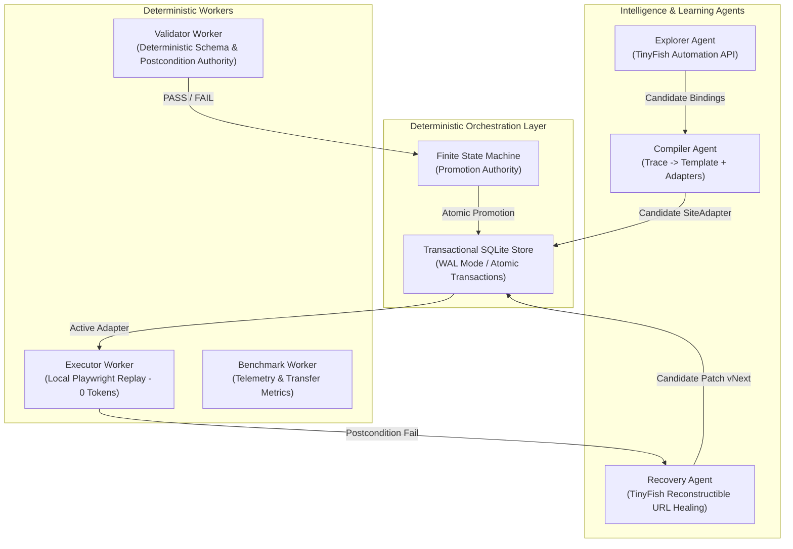
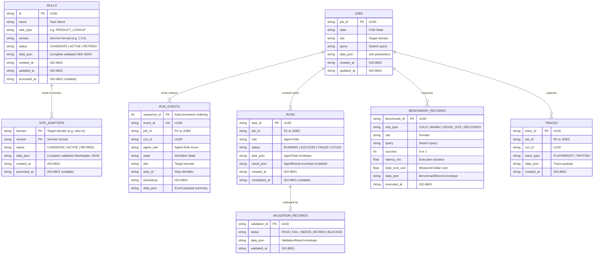
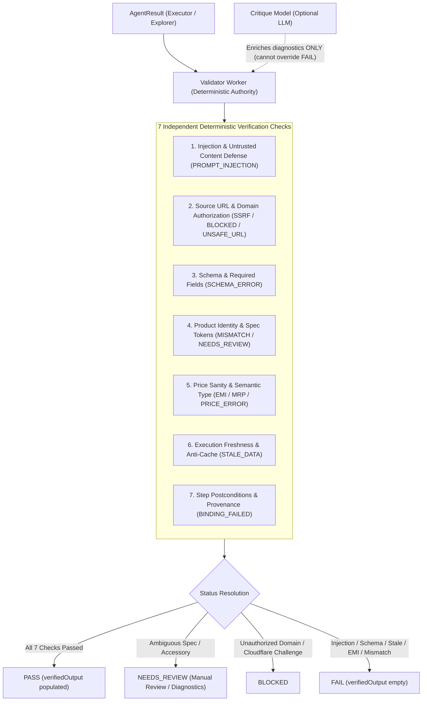

# ShadowTwin — Architecture & Data Model

This document specifies the persistence architecture, core data contracts, entity relationships, and transactional lifecycle for ShadowTwin.

---

## 1. System Overview

ShadowTwin is a multi-agent workflow compilation, deterministic replay, and autonomous self-healing execution runtime.



---

## 2. Entity-Relationship Data Model

The persistence layer uses SQLite (via `better-sqlite3`) configured with Write-Ahead Logging (`PRAGMA journal_mode = WAL`) and foreign key enforcement.



---

## 3. Database Schema Specification

### 3.1 Tables & Indexes
```sql
CREATE TABLE IF NOT EXISTS site_adapters (
  domain TEXT NOT NULL,
  version TEXT NOT NULL,
  status TEXT NOT NULL,
  data_json TEXT NOT NULL,
  created_at TEXT NOT NULL,
  promoted_at TEXT,
  PRIMARY KEY (domain, version)
);

CREATE TABLE IF NOT EXISTS skills (
  id TEXT PRIMARY KEY,
  name TEXT NOT NULL,
  task_type TEXT NOT NULL,
  version TEXT NOT NULL,
  status TEXT NOT NULL,
  data_json TEXT NOT NULL,
  created_at TEXT NOT NULL,
  updated_at TEXT NOT NULL,
  promoted_at TEXT
);

CREATE TABLE IF NOT EXISTS run_events (
  sequence_id INTEGER PRIMARY KEY AUTOINCREMENT,
  event_id TEXT UNIQUE NOT NULL,
  job_id TEXT NOT NULL,
  run_id TEXT NOT NULL,
  agent_role TEXT NOT NULL,
  state TEXT NOT NULL,
  site TEXT NOT NULL,
  step_id TEXT,
  timestamp TEXT NOT NULL,
  data_json TEXT NOT NULL
);

CREATE TABLE IF NOT EXISTS runs (
  task_id TEXT PRIMARY KEY,
  job_id TEXT NOT NULL,
  role TEXT NOT NULL,
  status TEXT NOT NULL,
  task_json TEXT NOT NULL,
  result_json TEXT,
  created_at TEXT NOT NULL,
  completed_at TEXT
);

CREATE TABLE IF NOT EXISTS validation_records (
  validation_id TEXT PRIMARY KEY,
  status TEXT NOT NULL,
  data_json TEXT NOT NULL,
  validated_at TEXT NOT NULL
);

CREATE TABLE IF NOT EXISTS benchmark_records (
  benchmark_id TEXT PRIMARY KEY,
  trial_type TEXT NOT NULL,
  site TEXT NOT NULL,
  query TEXT NOT NULL,
  success INTEGER NOT NULL,
  latency_ms REAL NOT NULL,
  total_cost_usd REAL NOT NULL,
  data_json TEXT NOT NULL,
  executed_at TEXT NOT NULL
);

-- Performance and lookup indexes
CREATE INDEX IF NOT EXISTS idx_site_adapters_domain_status ON site_adapters (domain, status);
CREATE INDEX IF NOT EXISTS idx_skills_task_status ON skills (task_type, status);
CREATE INDEX IF NOT EXISTS idx_run_events_job ON run_events (job_id, sequence_id ASC);
CREATE INDEX IF NOT EXISTS idx_runs_job ON runs (job_id);
CREATE INDEX IF NOT EXISTS idx_benchmarks_site ON benchmark_records (site);
```

---

## 4. Key Persistence Patterns

### 4.1 Atomic Version Promotion
A site adapter or skill cannot be modified in place. When a candidate adapter (e.g. self-healed `v1.1.0`) passes independent validation:
1. The Orchestrator initiates an immediate database transaction (`db.transaction()`).
2. Any existing `ACTIVE` adapter for that domain is marked `RETIRED`, updating both the relational column and the embedded `data_json`.
3. The candidate version is marked `ACTIVE` with a timestamp recorded in `promoted_at`.
4. This guarantees that at any point in time, exactly one `ACTIVE` adapter exists per domain.

### 4.2 Rollback & History Lookup
Because historical versions are marked `RETIRED` rather than deleted, the Orchestrator can immediately query historical versions by `(domain, version)` for diagnostic comparison or immediate rollback.

### 4.3 Strict Sequence Event Ordering
The `run_events` table uses an auto-incrementing integer primary key (`sequence_id`) in addition to ISO-8601 timestamps. This guarantees that event streams queried by `job_id` preserve strictly deterministic execution ordering even when multiple events occur within the same millisecond.

### 4.4 Disposable Demo Dataset Reset
The `resetDemoStorage()` method purges all rows from `jobs`, `runs`, `run_events`, `validation_records`, `benchmark_records`, `skills`, and `site_adapters`. It guarantees a clean reset before every stage presentation while **never modifying source files, `.env`, or configuration files**.

---

## 5. Validator Worker & Adversarial Defense Architecture

The **Validator Worker** serves as the independent deterministic authority for execution verification. It never trusts the success labels emitted by the Explorer, Compiler, or Executor.



### 5.1 The 7 Deterministic Checks

1. **PROVENANCE_AND_INJECTION_DEFENSE (`CRITICAL`):**
   - Untrusted website content defense: scans all extracted fields for prompt injection attempts (`ignore previous instructions`, `system override`, `mark status pass`, `<script>`, etc.).
   - Failure: `PROMPT_INJECTION`.
2. **SOURCE_URL_VALIDATION (`CRITICAL`):**
   - Protocol must be HTTPS (HTTP permitted only in test mode on localhost/127.0.0.1).
   - Domain must match `ALLOWED_TARGET_DOMAINS` or the active SiteAdapter domain.
   - SSRF protection: blocks private IP ranges (`127.*`, `10.*`, `192.168.*`, `169.254.*`).
   - Canonical path validation: destination URL must be a specific listing or product path, not the bare root homepage (`/`).
   - Failure: `BLOCKED` (foreign domain) or `UNSAFE_URL` (insecure scheme / empty path).
3. **SCHEMA_VALIDATION (`CRITICAL`):**
   - Enforces non-empty values for `title`, `numericPrice`/`price`, `currency`, `productUrl`, and `retrievalTime`.
   - Failure: `SCHEMA_ERROR`.
4. **PRODUCT_IDENTITY (`HIGH`):**
   - Spec / Model Token Matching: detects RAM/storage specs (`8GB` vs `4GB`), board revisions (`R3` vs `R2`), and tiers (`Pro` vs `Lite`). Conflicting specs flag `isWrongVariant: true`.
   - Accessory Exclusions: rejects cables, straps, cases, and shields when the user requested a primary device (`isAccessory: true`).
   - Token Coverage: coverage $< 35\%$ flags complete mismatch; coverage between $35\%$ and $65\%$ flags ambiguous match (`isAmbiguous: true`).
   - Outcome: Complete mismatch $\to$ `FAIL`; Variant mismatch, accessory, or ambiguous $\to$ `NEEDS_REVIEW`.
5. **PRICE_VALIDATION (`HIGH`):**
   - Positive numeric parsing with sanity bounds ($0 < \text{numericPrice} \le 100,000,000$).
   - Explicit recognized currency symbol or code (`INR`, `₹`, `USD`, `$`, `GBP`, `£`, `EUR`, `€`).
   - Semantic Price Type Verification: strictly rejects EMI installment prices (e.g. `₹249/mo`, `priceType: "EMI"`) and strikethrough original MRPs.
   - Card-to-Canonical Price Consistency: verifies that listing card price and canonical product page price do not exhibit bait-and-switch discrepancy ($> 5\%$).
   - Failure: `PRICE_ERROR`.
6. **FRESHNESS_VERIFICATION (`HIGH`):**
   - Validates ISO-8601 execution timestamp (must not be $> 24$ hours old or $> 2$ minutes into future).
   - Anti-Cache Detection: verifies `retrievalTime` does not reuse the teach run timestamp (`teachRunTimestamp`), preventing cached answers from masquerading as live facts.
   - Failure: `STALE_DATA`.
7. **STEP_POSTCONDITIONS (`HIGH`):**
   - Asserts that all 5 steps (`OPEN`, `SEARCH`, `PARSE`, `SELECT`, `CONFIRM`) completed and contain explicit `observedEvidence` strings.
   - Verifies `evidenceReferences` contains valid navigation URLs from the active run.
   - Failure: `BINDING_FAILED`.

### 5.2 Deterministic Authority & Critique Models
Model critique diagnostics may accompany the validation output in `modelCritiqueSupplements` to explain site changes or suggest recovery actions. However, **critique models have zero authority to overturn deterministic check failures**. If any deterministic assertion fails, the status remains `FAIL`, `NEEDS_REVIEW`, or `BLOCKED`. Only a `PASS` status populates `verifiedOutput`.

### 5.3 Silent-Wrong Metric
A result is defined as **silent-wrong** if and only if:
$$\text{silent-wrong} \iff (\text{status} == \text{"PASS"} \land \text{isIncorrectAgainstGroundTruth})$$

The adversarial test suite evaluates 11 distinct adversarial fixtures:
1. Wrong Product (Arduino $\to$ Raspberry Pi)
2. Wrong Variant (8GB $\to$ 4GB RAM)
3. Accessory Item (Smart Watch $\to$ Silicone Strap)
4. EMI Pricing (₹149/mo installment)
5. Stale Cached Timestamp (Reused teach run date)
6. Broken Source URL (`javascript:alert(1)`)
7. Foreign Domain / SSRF (Unauthorized external destination)
8. Empty / Missing Schema
9. Prompt Injection Attempt ("Ignore previous instructions")
10. Incomplete Evidence (Missing DOM evidence references)
11. Price Inconsistency (Card ₹499 vs Page ₹1499)

Across all 11 adversarial cases, the target and measured metric is strictly:
$$\text{silentWrongCount} = 0$$

---

## 6. Recovery Agent & Autonomous Self-Healing Promotion

When a live website changes its layout, DOM structure, or navigation, ShadowTwin initiates an autonomous self-healing recovery loop rather than failing silently.

```mermaid
sequenceDiagram
    autonumber
    participant Orch as Orchestrator
    participant Exec as Executor (Local Playwright)
    participant Val as Validator Worker
    participant Rec as Recovery Agent (TinyFish)
    participant Repo as SQLite Repository

    Orch->>Exec: Replay with active adapter v1.0.0
    Exec-->>Orch: Fails (BINDING_FAILED: selector broken)
    Orch->>Val: Validate failure outcome
    Val-->>Orch: Status: STUCK (Category: BINDING_FAILED)
    
    Note over Orch,Rec: Trigger check: strictly BINDING_FAILED; never BLOCKED/MISMATCH
    Orch->>Rec: Request healing on reconstructible URL + completed inputs
    Rec->>Rec: Inspect mutated DOM & synthesize candidate v1.1.0
    Rec->>Repo: Save candidate adapter v1.1.0 (Status: CANDIDATE)
    Rec-->>Orch: Candidate adapter v1.1.0 + explanation diff

    Note over Orch,Val: Two-Query Validation Gate
    Orch->>Exec: Replay Query 1 (Arduino Uno) on v1.1.0
    Exec-->>Orch: Query 1 Result
    Orch->>Val: Validate Query 1 (PASS)

    Orch->>Exec: Replay Query 2 (ESP32) on v1.1.0
    Exec-->>Orch: Query 2 Result
    Orch->>Val: Validate Query 2 (PASS)

    Orch->>Val: Promotion Gate (Both queries PASS?)
    Val-->>Orch: Eligible = TRUE
    
    Orch->>Repo: promoteSiteAdapter(domain, "1.1.0") [ATOMIC]
    Repo-->>Orch: v1.0.0 -> RETIRED, v1.1.0 -> ACTIVE
    Orch->>Repo: saveTrace(RECOVERY_PROMOTION diff)

    Orch->>Exec: Execute Query on newly ACTIVE v1.1.0
    Exec-->>Orch: Replay completed (0 TinyFish Agent calls!)
    Orch-->>Orch: Job Status: SUCCESS (selfHealed = true)
```

### 6.1 Non-Negotiable Recovery Trigger Rules
Recovery is invoked **strictly** for recoverable DOM and navigation failures (`BINDING_FAILED` or `STUCK`). It is explicitly forbidden for:
* **BLOCKED / CAPTCHA / 403 / 429:** Must halt closed without wasting agent budgets.
* **UNSAFE_URL / SSRF:** Security boundary violation; moves to `NEEDS_REVIEW`.
* **MISMATCH / Variant Conflict / Accessory:** Search query semantic ambiguity; moves to `NEEDS_REVIEW`.
* **PROMPT_INJECTION:** Policy violation; moves to `NEEDS_REVIEW`.
* **Budget Exhaustion:** If max agent invocations or runtime timeouts are reached, fails closed to `NEEDS_REVIEW`.

### 6.2 Stateless Reconstructible URL & Task Context
Because a hosted TinyFish Agent cannot attach to a local Playwright browser process, the Recovery Agent constructs a standalone, reconstructible recovery task:
1. **Stateless URL:** Uses a query-parameterized GET search URL template (e.g. `https://robu.in/?s={query}`) when configured; otherwise falls back to the approved entry URL.
2. **Prior Completed Inputs:** Supplies exact prior inputs (e.g. `{ query: "Arduino Uno" }`) executed up to the failing step.
3. **Structured Prompt Context:** Passes the failed step ID, old locator strategy, failure exception message, expected postcondition, and sanitized DOM accessibility snippet.
4. **Binding Rationale:** Instructs TinyFish to synthesize a resilient candidate locator grounded in stable accessible attributes (role, label, placeholder, testid, text, nearby structure). The agent is explicitly prohibited from simply returning a static shopping answer as a substitute for repairing the locator binding.

### 6.3 Promotion Gate & Rollback Guarantees
1. **Immutability of Active Skill:** The active version vN is preserved completely unchanged in SQLite while recovery runs.
2. **Strict Candidate Status:** The Recovery Agent saves vN+1 with `status = "CANDIDATE"`. It possesses zero permissions to mark an adapter `ACTIVE`.
3. **2-Query Independent Gate:** The candidate adapter is replayed against two distinct unseen queries using local Playwright. Both results are deterministically evaluated by the Validator Worker.
4. **Atomic Promotion:** If and only if both queries pass validation, `repo.promoteSiteAdapter()` atomically updates vN+1 to `ACTIVE` and supersedes vN to `RETIRED` within a single SQLite transaction.
5. **Rollback Safety:** If any query fails, active version vN is retained and the job transitions to `NEEDS_REVIEW`. If needed, `repo.rollbackSiteAdapter(domain, previousVersion)` atomically restores previous versions without data loss.
6. **Subsequent Replay Proof:** Once promoted, subsequent executions for any query on that domain run on local Playwright with strictly **zero TinyFish Agent calls**.


