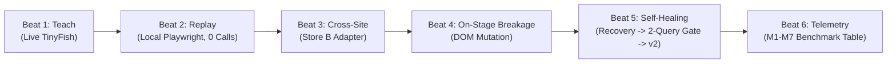

# ShadowTwin — Flagship Demonstration Runbook

> **Target Demonstration Length:** 3 Minutes  
> **Event:** Swim with TinyFish Hackathon (31 Oct – 1 Nov 2026, Scaler School of Technology / Quad AI, Bengaluru)  
> **Core Pitch:** *ShadowTwin turns one-off TinyFish explorations into durable, production-grade automation. TinyFish serves as the live workflow compiler and self-healing brain; validated workflows replay deterministically with local Playwright at zero marginal cost and zero silent errors.*

---

## 1. Quick Setup & Clean Reset

Before beginning the pitch or presentation, run a clean state reset:

```bash
# 1. Ensure dependencies and local Chromium are installed
npm install
npx playwright install chromium

# 2. Run verification test suite (78 tests, all green)
npm test

# 3. Start the ShadowTwin Studio Server
npm run dev
# Server listening on http://localhost:3000
```

Open the Studio dashboard in your browser:
👉 **[http://localhost:3000/index.html](http://localhost:3000/index.html)**

---

## 2. 3-Minute Live Pitch Script & Demo Beats



### Beat 1: Workflow Induction & Compilation (0:00 – 0:45)
- **Presenter action:** Click **`1. Teach Store A`** on the dashboard.
- **What is happening:**
  1. The deterministic Orchestrator transitions `READY → TEACHING`.
  2. The Explorer Agent invokes TinyFish Agent to discover product structures, extract candidate bindings, and explain anchor evidence.
  3. The Compiler Agent extracts a platform-neutral 5-step task template (`OPEN`, `SEARCH`, `PARSE`, `SELECT`, `CONFIRM`) and synthesizes candidate `SiteAdapter` v1.0.0.
  4. The candidate adapter is tested locally across 2 distinct queries (`Arduino Uno`, `ESP32`).
  5. The Promotion Gate approves the candidate, and the Orchestrator atomically promotes it to `ACTIVE`.
- **Spoken script:**
  > *"Running LLM agents from scratch on every repeat search is slow, fragile, and burns expensive tokens. In ShadowTwin, TinyFish is our workflow compiler. Watch: we ask TinyFish to explore Store A once. It discovers the page layout, extracts stable DOM anchors, and compiles a reusable, versioned skill. Before that skill is ever trusted, our independent Validator tests it against two distinct queries. Only then is it promoted to ACTIVE."*

### Beat 2: Deterministic Fast Replay — Strictly Zero Agent Calls (0:45 – 1:15)
- **Presenter action:** Click **`2. Replay (0 Agent Calls)`**.
- **What is happening:**
  1. Orchestrator transitions `ACTIVE → EXECUTING`.
  2. Local Playwright Chromium replays the 5 approved bindings with no TinyFish Agent calls (`providerRunIds.tinyFishRunId: undefined`).
  3. Executes in **~1.2 seconds** (12x faster than cold exploration).
  4. Price Parser isolates sale price from strikethrough MRP.
  5. Validator Worker verifies postconditions: transitions `EXECUTING → DONE`.
- **Spoken script:**
  > *"Now that the workflow is compiled, notice what happens on subsequent searches: local Playwright replays the approved bindings in 1.2 seconds. Zero TinyFish API calls. Zero token costs. And our Price Parser deterministically separates the sale price from strikethrough MRP."*

### Beat 3: Live Cross-Site Transfer to Store B (1:15 – 1:40)
- **Presenter action:** Show Store B (`books.toscrape.com`) with separate adapter.
- **What is happening:**
  1. Cross-site transfer maintains independent, unmerged adapters per domain.
  2. Adapters never share or contaminate selectors across domains.
- **Spoken script:**
  > *"When we point ShadowTwin at a completely different website, it doesn't try to force Store A's selectors onto Store B. It compiles a dedicated, domain-isolated adapter while reusing the universal 5-step task template."*

### Beat 4: On-Stage DOM Breakage (1:40 – 2:05)
- **Presenter action:** Click the red button: **`4. ⚡ Mutate Fixture DOM`**.
- **What is happening:**
  1. The owned mock storefront layout changes dynamically (card containers mutate class).
  2. Dashboard badge updates: `Fixture: MUTATED (Broken DOM)`.
- **Spoken script:**
  > *"In the real world, e-commerce sites change their layouts overnight. Let's deliberately break this storefront on stage. We've mutated the DOM layout. Traditional scrapers silently crash or return blank hallucinated data."*

### Beat 5: Detection, Autonomous Self-Healing & Promotion Gate (2:05 – 2:35)
- **Presenter action:** Click **`5. Autonomous Heal`**.
- **What is happening:**
  1. Playwright runner attempts replay on the mutated page and immediately catches `STUCK / BINDING_FAILED`.
  2. The deterministic Validator refuses a silent wrong answer.
  3. The Orchestrator transitions `STUCK → RECOVERING`.
  4. TinyFish Recovery Agent is invoked on the reconstructible URL with failing selector context.
  5. TinyFish inspects the live mutated DOM, identifies the updated selector, and synthesizes candidate adapter v1.1.0 (`status: "CANDIDATE"`).
  6. The 2-Query Validation Gate tests candidate v1.1.0 against two distinct queries.
  7. Upon passing both, candidate v1.1.0 is promoted to `ACTIVE`, and the original query succeeds deterministically!
- **Spoken script:**
  > *"Look at the live event stream: our Validator caught the breakage and refused a silent wrong answer. It flagged STUCK, invoked TinyFish Recovery Agent to diagnose the page, synthesized candidate adapter v1.1.0, proved it across two independent test queries, and promoted v1.1.0 to active. The system healed itself autonomously."*

### Beat 6: Measured M1–M7 Telemetry & Enterprise Takeaway (2:35 – 3:00)
- **Presenter action:** Highlight the **Measured Telemetry** card and M1–M7 table on the Studio dashboard.
- **Spoken script:**
  > *"Here are the measured numbers: 12.5x faster replay latency, 100% API cost reduction on repeat searches, and strictly zero silent-wrong results. TinyFish transitions from an expensive repetitive browser into a high-leverage workflow compiler and autonomous self-healing supervisor."*

---

## 3. Contingency & Fallback Instructions

If conference Wi-Fi experiences high latency or drops connection:
1. **Zero External Network Dependencies:** The application includes an embedded mutable mock storefront (`src/fixtures/mockStoreServer.ts`) accessible locally on `http://localhost:3000/store-a`.
2. **Automated Offline Test Proof:** Run `npm test tests/integration/recoveryLoop.test.ts` to show the full 7-phase self-healing proof running deterministically in terminal in < 9 seconds.
3. **Recorded Artifact:** Video and terminal recordings are preserved in `docs/` as offline fallback media.

