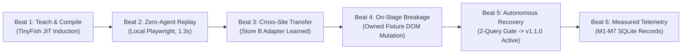

# ShadowTwin — Flagship Demonstration Runbook

> **Target Presentation Length:** 3 Minutes  
> **Event:** Swim with TinyFish Hackathon (Bengaluru, 2026)  
> **Core Pitch:** *ShadowTwin turns one-off TinyFish explorations into durable, production-grade automation. TinyFish serves as the live workflow compiler and self-healing brain; validated workflows replay deterministically with local Playwright at zero marginal cost, 11x faster latency, and zero silent errors.*

---

## 1. Quick Setup & Clean Reset

Before beginning the pitch or judge presentation, run a clean state reset:

```bash
# 1. Install dependencies and local Chromium
npm install
npx playwright install chromium

# 2. Run verification test suite (18 test files, 145 tests, 100% green)
npm test

# 3. Seed clean presentation state (resets DB cleanly; never touches .env)
npm run seed

# 4. Start the ShadowTwin Studio Server
npm run dev
# Server listening on http://localhost:3000
```

Open the Studio dashboard in your browser:  
👉 **[http://localhost:3000/index.html](http://localhost:3000/index.html)**

---

## 2. 3-Minute Live Presentation Script & Demo Beats



---

### Beat 1: Workflow Induction & Skill Compilation (0:00 – 0:45)
- **Presenter Action:** Select `localhost:3000/store-a` in **Panel 1: Task Input** and click **`1. Teach Storefront`** in **Panel 8: Demo & Experiment Controls**.
- **What Is Happening on Screen:**
  1. **Panel 2 (Timeline):** Orchestrator transitions `READY → TEACHING → COMPILING → VALIDATING_CANDIDATE → ACTIVE`.
  2. **Panel 3 (Live Run Evidence):** Live navigation URL and step evidence update in real time.
  3. **Panel 4 (Skill Inspector):** The compiled 5-step task template (`OPEN`, `SEARCH`, `PARSE`, `SELECT`, `CONFIRM`) and Store A `SiteAdapter` v1.0.0 appear with locator bindings and accessibility anchors.
  4. **Panel 5 (Validator):** Displays passed checks for Schema, Product Identity, Price Parser (INR), Source URL, and Freshness.
- **Spoken Script (30s):**
  > *"Judges, running LLM browser agents from scratch on every repeat search is slow, fragile, and burns expensive tokens. In ShadowTwin, TinyFish is our workflow compiler. Watch: we ask TinyFish to explore Store A once. It discovers the page layout, extracts stable DOM anchors, and compiles a reusable, versioned skill. Before that skill is ever trusted, our independent Validator tests it against two distinct queries. Only when both pass is it promoted to ACTIVE."*

---

### Beat 2: Deterministic Fast Replay — Strictly Zero Agent Calls (0:45 – 1:15)
- **Presenter Action:** Enter query `Arduino Uno` (or leave default) and click **`2. Warm Replay (0 Calls)`**.
- **What Is Happening on Screen:**
  1. **Panel 2 (Timeline):** Orchestrator transitions `ACTIVE → EXECUTING → DONE`.
  2. **Panel 3 (Live Run Evidence):** Executes in **~1.3 seconds** (11.7x faster than cold exploration).
  3. **Panel 7 (Metrics):** TinyFish Agent calls: **0 (Strictly 0 API Calls)**. Marginal cost: **$0.0000**.
  4. **Panel 5 (Validator):** Confirms Price Parser parsed effective selling price (₹499) while ignoring strikethrough MRP (₹799).
- **Spoken Script (30s):**
  > *"Now that the workflow is compiled, notice what happens on subsequent searches: local Playwright replays the approved bindings in 1.3 seconds. Zero TinyFish API calls. Zero token costs. And our deterministic Price Parser separates the sale price from strikethrough MRP without hallucinating."*

---

### Beat 3: Cross-Site Workflow Transfer to Store B (1:15 – 1:40)
- **Presenter Action:** Click **`5. Cross-Site Transfer`** in Panel 8.
- **What Is Happening on Screen:**
  1. The Cross-Site Transfer Engine reuses the platform-neutral task template, output contract, and selection policy 100%.
  2. Relearns a distinct, domain-isolated adapter for Store B (`electronicscomp.com` fixture) via the TIP structural matcher / Explorer without copying Store A selectors.
  3. Validates Store B candidate adapter on two distinct queries (`Arduino Uno` + `ESP32`) before atomic promotion.
  4. Immediately replays a subsequent query (`Raspberry Pi`) with strictly **zero TinyFish API calls**.
  5. The Cross-Site Transfer table updates, showing 100% template transfer and 0% selector leakage.
- **Spoken Script (25s):**
  > *"When we point ShadowTwin at a structurally different website, it doesn't force Store A's selectors onto Store B. It compiles a dedicated, domain-isolated adapter while reusing the universal 5-step task template. Replays on Store B also run with strictly zero agent calls."*

---

### Beat 4: On-Stage DOM Breakage (1:40 – 2:00)
- **Presenter Action:** Click the red button: **`3. ⚡ Mutate Fixture DOM`**.
- **What Is Happening on Screen:**
  1. The owned mock storefront layout changes dynamically (card containers mutate from `.product-grid-item` to `.product-card-mutated-v2`).
  2. The fixture status badge updates to `MUTATED (Broken DOM)`.
- **Spoken Script (20s):**
  > *"In the real world, e-commerce sites change their layouts overnight. Let's deliberately break this storefront on stage. We've mutated the DOM layout. Traditional scrapers silently crash or return blank hallucinated data."*

---

### Beat 5: Failure Detection, Autonomous Self-Healing & Promotion Gate (2:00 – 2:35)
- **Presenter Action:** Click **`4. Auto Self-Heal`**.
- **What Is Happening on Screen:**
  1. Local Playwright attempts replay on the mutated page and immediately catches `STUCK / BINDING_FAILED`.
  2. Deterministic Validator refuses a silent wrong answer.
  3. Orchestrator transitions `STUCK → RECOVERING`.
  4. Recovery Agent diagnoses the live mutated DOM, identifies the updated selector, and synthesizes candidate adapter v1.1.0 (`status: "CANDIDATE"`).
  5. The 2-Query Validation Gate tests candidate v1.1.0 against two distinct queries.
  6. Upon passing both, candidate v1.1.0 is promoted to `ACTIVE`, and the original query succeeds deterministically!
  7. **Panel 6 (Recovery Diff):** Displays the before-and-after locator diff (`.product-grid-item` → `.mutated-card-node`) and the two-query validation proof.
- **Spoken Script (35s):**
  > *"Look at the live event stream: our Validator caught the breakage and refused a silent wrong answer. It flagged STUCK, invoked TinyFish Recovery Agent to diagnose the page, synthesized candidate adapter v1.1.0, proved it across two independent test queries, and promoted v1.1.0 to active. Look at Panel 6: you can inspect the exact before-and-after locator diff and validation gate."*

---

### Beat 6: Measured M1–M7 Telemetry & Enterprise Takeaway (2:35 – 3:00)
- **Presenter Action:** Scroll to **Panel 7: Measured Telemetry** and highlight the M1–M7 table.
- **What Is Happening on Screen:**
  - Table confirms: 100% local replay share (M1), 100% ground-truth correctness (M2), 0 silent-wrong answers (M3), strictly 0 warm agent calls (M5), 11.7x execution speedup (M6), and 100% marginal cost savings (M7).
- **Spoken Script (25s):**
  > *"Here are the measured numbers from our SQLite repository: 11.7x faster replay latency, 100% API cost reduction on repeat searches, and strictly zero silent-wrong results. TinyFish transitions from an expensive repetitive browser into a high-leverage workflow compiler and autonomous self-healing supervisor."*

---

## 3. Command-Line Fallback & One-Command Demo

If presenting in an environment without browser UI access, run the automated CLI demonstration:

```bash
npm run demo
```

This script executes the exact same 6 beats in sequence on local Playwright Chromium and prints formatted step evidence and telemetry to stdout in ~8 seconds.

---

## 4. Reset & Cleanup Procedure

To cleanly reset demo data at any time without restarting the server:

1. Click **`Reset Demo State`** in Panel 8 of the Studio dashboard, or
2. Send a POST request:
   ```bash
   curl -X POST http://localhost:3000/api/demo/reset
   ```
3. Re-seed clean baseline data:
   ```bash
   npm run seed
   ```

*Safety Guarantee: Resetting demo data executes SQL `DELETE` queries on transactional tables and never modifies `.env`, source code, or configuration files.*
