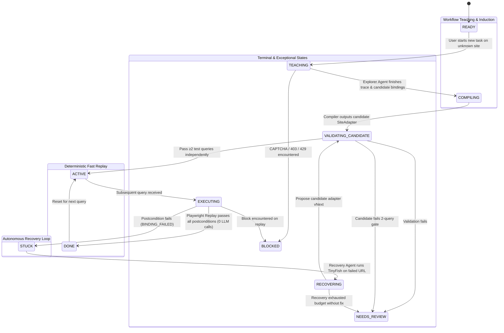

# ShadowTwin — Technical Implementation Plan

**System:** ShadowTwin (Multi-Agent Workflow Compilation, Deterministic Replay & Autonomous Self-Healing)  
**Target:** Swim with TinyFish Hackathon (6-Hour Sprint)  
**Status:** Approved Architecture & Phase Plan | **Date:** 1 November 2026  
**Source of Truth:** [`AGENTS.md`](../AGENTS.md) and [`Docs/ShadowTwin PRD`](./ShadowTwin%20-%20Product%20Requirements%20Document%204007ece3908b80978b7df58c8e9ee574.md)

---

## 1. Existing Stack & Recommendation

### 1.1 Repository Baseline Findings
* **Git Status:** Clean tree on branch `main` tracking `https://github.com/sagarrathi16/Tinyfish_Hackathon.git`.
* **Existing Files:** `AGENTS.md`, `CLAUDE.md`, and `Docs/` containing `ShadowTwin PRD`, `research.pdf`, and presentation slides.
* **Code / Manifests:** No application source code, package manifests (`package.json`, `requirements.txt`), lockfiles, or environment files currently exist.
* **Installed Runtimes:**
  * Node.js `v24.19.0`, npm `11.17.0`
  * Python `3.14.7`
  * TinyFish CLI `0.51.1` (verified connected to MCP at `https://agent.tinyfish.ai/mcp`, authenticated with active wallet balance)

### 1.2 Technology Stack Recommendation
In strict accordance with `AGENTS.md` ("*If starting from an empty repository, prefer TypeScript/Node for consistency with the TinyFish Workflow Memory reference and Stagehand integration*"), we retain and adopt a **minimal TypeScript / Node.js 24+** stack:
* **Language & Runtime:** TypeScript 5.x running on Node.js 24+ (`tsx` for dev execution and fast testing).
* **Browser Automation & Replay:** Official Playwright (`playwright` NPM package) using a local Chromium engine for deterministic, zero-token, sub-second replay.
* **Schema Validation & Contracts:** `zod` for all agent envelopes, task models, and for generating JSON Schemas supplied to the TinyFish Automation API.
* **Database & Persistence:** SQLite via `better-sqlite3` (synchronous WAL mode) for thread-safe, transactional storage of skills, adapters, runs, and events without microservice overhead.
* **Server & Dashboard UI:** Fastify or Express serving a lightweight, single-page server-rendered or static HTML/Tailwind Studio dashboard.

---

## 2. Proposed Directory Structure & Module Responsibilities

The codebase enforces strict logical agent roles with explicit inputs, outputs, budgets, and traces. Unrestricted agent group chats are strictly prohibited.

```
c:\Users\sagar\Projects\TinyFish\
├── AGENTS.md                          # Repository instructions and agent rules
├── CLAUDE.md                          # Pointer to AGENTS.md
├── THIRD_PARTY_NOTICES.md             # Attribution & license records
├── .env.example                       # Safe template with placeholder values
├── .gitignore                         # Excludes secrets, traces, sqlite db, profiles
├── package.json                       # Dependencies & scripts
├── tsconfig.json                      # Strict TypeScript configuration
├── docs/                              # Project documentation
│   ├── implementation-plan.md         # This specification document
│   ├── architecture.md                # System architecture diagrams & data flow
│   ├── demo-runbook.md                # 3-minute stage pitch sequence & reset commands
│   └── benchmark.md                   # Frozen queries, test methodology & metrics
├── src/
│   ├── config/                        # Server-side configuration & secret boundary
│   │   └── env.ts                     # Zod-validated environment config with redaction
│   ├── types/                         # Canonical typed contracts & Zod schemas
│   │   ├── agent.ts                   # AgentTask, AgentResult, RunEvent
│   │   ├── skill.ts                   # Skill, SiteAdapter, StepBinding
│   │   ├── validation.ts              # ValidationResult, PostconditionConfig
│   │   └── benchmark.ts               # BenchmarkRecord, TransferMetrics
│   ├── persistence/                   # Transactional SQLite store
│   │   ├── database.ts                # SQLite connection with WAL & migrations
│   │   ├── skillStore.ts              # Versioned skill & adapter CRUD operations
│   │   └── runStore.ts                # Run history, event log, and audit trail
│   ├── orchestrator/                  # Deterministic state machine & scheduler
│   │   ├── stateMachine.ts            # State transition engine and promotion gate
│   │   ├── scheduler.ts               # Bounded concurrency runner (max 2 explorers)
│   │   └── budget.ts                  # Per-run timeouts and API call limits
│   ├── agents/                        # Logical agent roles
│   │   ├── explorer.ts                # Explorer Agent: TinyFish Automation API client
│   │   ├── compiler.ts                # Compiler Agent: Synthesizes skill & adapters
│   │   └── recovery.ts                # Recovery Agent: TinyFish failure diagnosis & patch
│   ├── executor/                      # Deterministic execution (Non-LLM)
│   │   ├── playwrightRunner.ts        # Standalone local Playwright replay engine
│   │   └── domAnchors.ts              # Semantic element grounding (role, ARIA, text)
│   ├── validator/                     # Deterministic verification authority
│   │   ├── postconditions.ts          # Step 1-5 postconditions (OPEN -> CONFIRM)
│   │   └── resultValidator.ts         # Schema, INR price regex, identity, freshness
│   ├── benchmark/                     # Evaluation & telemetry engine
│   │   ├── harness.ts                 # Executes cold vs warm vs recovery trials
│   │   └── metrics.ts                 # Computes latency, token spend, silent-wrong rate
│   ├── fixtures/                      # Owned mutable test storefront
│   │   ├── server.ts                  # Local test shop for deterministic DOM mutation
│   │   └── static/                    # Product catalog HTML with toggleable classes
│   └── ui/                            # Minimal Studio Dashboard
│       ├── server.ts                  # API & static server for telemetry UI
│       └── public/                    # Interactive dashboard for live demo
└── tests/                             # Unit tests & fixture integration tests
    ├── unit/
    │   ├── env.test.ts
    │   ├── validator.test.ts
    │   └── stateMachine.test.ts
    └── integration/
        ├── tinyfishAdapter.test.ts
        └── playwrightReplay.test.ts
```

### Module Responsibilities:
1. **`Orchestrator` (`src/orchestrator/`):** The deterministic supervisor. Schedules work, tracks dependencies, enforces API step/timeout budgets, persists events, and acts as the **sole authority that promotes candidate skills to active status**.
2. **`Explorer Agent` (`src/agents/explorer.ts`):** Talks exclusively to the official TinyFish Automation API (`/v1/automation/run` or `/run-sse`). Explores the target storefront and returns structured page observations and candidate bindings.
3. **`Compiler Agent` (`src/agents/compiler.ts`):** Converts validated traces into platform-neutral task templates, site-specific adapter candidates, and deterministic postcondition definitions. Never fabricates evidence.
4. **`Executor Worker` (`src/executor/playwrightRunner.ts`):** Standalone local Playwright instance. Replays approved site bindings deterministically without calling TinyFish Agent or Browser API.
5. **`Validator Worker` (`src/validator/`):** Independent deterministic gatekeeper. Verifies schemas, INR currency formats, product title matching, and postconditions. Authority for `PASS / FAIL`.
6. **`Recovery Agent` (`src/agents/recovery.ts`):** When a postcondition fails (`BINDING_FAILED`), starts a targeted TinyFish Agent session using a reconstructible URL and prior step inputs. Proposes replacement bindings; cannot promote skills directly.
7. **`Benchmark Worker` (`src/benchmark/`):** Runs frozen test sets across cold, warm, cross-site, and recovery states to compute latency, API spend, and accuracy metrics.

---

## 3. Exact Typed Contracts

All system boundaries communicate through typed Zod schemas.

### 3.1 `AgentTask` & `AgentResult`
```typescript
import { z } from "zod";

export const AgentRoleSchema = z.enum([
  "ORCHESTRATOR",
  "EXPLORER",
  "COMPILER",
  "EXECUTOR",
  "VALIDATOR",
  "RECOVERY",
  "BENCHMARK"
]);
export type AgentRole = z.infer<typeof AgentRoleSchema>;

export const AgentTaskSchema = z.object({
  taskId: z.string().uuid(),
  jobId: z.string().uuid(),
  role: AgentRoleSchema,
  action: z.enum(["TEACH", "REPLAY", "VALIDATE", "RECOVER", "BENCHMARK"]),
  targetUrl: z.string().url(),
  query: z.string().min(1),
  domain: z.string().min(1),
  reconstructibleUrl: z.string().url().optional(),
  priorStepInputs: z.record(z.unknown()).optional(),
  failureContext: z.object({
    failedStep: z.string(),
    errorReason: z.string(),
    domSnapshotSnippet: z.string().optional()
  }).optional(),
  stepTimeoutSeconds: z.number().int().positive().default(30),
  totalBudgetSeconds: z.number().int().positive().default(120),
  createdAt: z.string().datetime()
});
export type AgentTask = z.infer<typeof AgentTaskSchema>;

export const ExtractedProductSchema = z.object({
  title: z.string().min(1),
  numericPrice: z.number().positive(),
  currency: z.literal("INR"),
  productUrl: z.string().url(),
  evidenceUrl: z.string().url(),
  retrievedAt: z.string().datetime()
});
export type ExtractedProduct = z.infer<typeof ExtractedProductSchema>;

export const AgentResultSchema = z.object({
  taskId: z.string().uuid(),
  jobId: z.string().uuid(),
  role: AgentRoleSchema,
  status: z.enum(["SUCCESS", "FAILED", "STUCK", "NEEDS_REVIEW", "BLOCKED"]),
  tinyFishRunId: z.string().optional(),
  candidateBindings: z.record(z.string()).optional(),
  extractedProducts: z.array(ExtractedProductSchema).optional(),
  selectedProduct: ExtractedProductSchema.optional(),
  rawObservations: z.string().optional(),
  errorDetails: z.object({
    category: z.enum(["BINDING_FAILED", "BLOCKED", "MISMATCH", "TIMEOUT", "NETWORK_ERROR"]),
    message: z.string(),
    step: z.string()
  }).optional(),
  latencyMs: z.number().nonnegative(),
  stepCount: z.number().int().nonnegative().default(0),
  estimatedCostUsd: z.number().nonnegative().default(0),
  completedAt: z.string().datetime()
});
export type AgentResult = z.infer<typeof AgentResultSchema>;
```

### 3.2 `RunEvent`
```typescript
export const RunEventSchema = z.object({
  eventId: z.string().uuid(),
  jobId: z.string().uuid(),
  runId: z.string().uuid(),
  agentRole: AgentRoleSchema,
  state: z.string(),
  stepId: z.string().optional(),
  eventType: z.enum(["STATE_TRANSITION", "STEP_START", "STEP_COMPLETE", "POSTCONDITION_PASS", "POSTCONDITION_FAIL", "ERROR", "BUDGET_EXCEEDED"]),
  details: z.record(z.unknown()),
  redactedError: z.string().optional(),
  timestamp: z.string().datetime()
});
export type RunEvent = z.infer<typeof RunEventSchema>;
```

### 3.3 `StepBinding`, `SiteAdapter` & `Skill`
```typescript
export const StepBindingSchema = z.object({
  stepName: z.enum(["OPEN", "SEARCH", "PARSE", "SELECT", "CONFIRM"]),
  primarySelector: z.string().min(1),
  fallbackSelectors: z.array(z.string()).default([]),
  anchorAttributes: z.object({
    role: z.string().optional(),
    ariaLabel: z.string().optional(),
    placeholder: z.string().optional(),
    testId: z.string().optional(),
    exactText: z.string().optional()
  }).default({}),
  provenance: z.enum(["TINYFISH_EXPLORER", "TINYFISH_RECOVERY", "TIP_GROUNDED", "MANUAL"]),
  sourceRunId: z.string().optional(),
  updatedAt: z.string().datetime()
});
export type StepBinding = z.infer<typeof StepBindingSchema>;

export const SiteAdapterSchema = z.object({
  adapterId: z.string().uuid(),
  domain: z.string().min(1),
  version: z.string().regex(/^\d+\.\d+\.\d+$/),
  status: z.enum(["CANDIDATE", "ACTIVE", "STALE", "RETIRED"]),
  entryUrl: z.string().url(),
  bindings: z.record(StepBindingSchema), // keyed by stepName
  testedQueries: z.array(z.string()).min(0),
  validationPassCount: z.number().int().nonnegative().default(0),
  createdAt: z.string().datetime(),
  promotedAt: z.string().datetime().optional()
});
export type SiteAdapter = z.infer<typeof SiteAdapterSchema>;

export const TaskStepDefinitionSchema = z.object({
  order: z.number().int().positive(),
  name: z.enum(["OPEN", "SEARCH", "PARSE", "SELECT", "CONFIRM"]),
  description: z.string(),
  requiredOutputs: z.array(z.string()),
  postconditionName: z.string()
});

export const SkillSchema = z.object({
  skillId: z.string().uuid(),
  taskName: z.literal("PRODUCT_LOOKUP"),
  version: z.string().regex(/^\d+\.\d+\.\d+$/),
  status: z.enum(["CANDIDATE", "ACTIVE", "RETIRED"]),
  template: z.array(TaskStepDefinitionSchema),
  activeAdapterIds: z.record(z.string()), // domain -> adapterId
  createdAt: z.string().datetime(),
  updatedAt: z.string().datetime()
});
export type Skill = z.infer<typeof SkillSchema>;
```

### 3.4 `ValidationResult` & `BenchmarkRecord`
```typescript
export const PostconditionCheckSchema = z.object({
  stepName: z.string(),
  passed: z.boolean(),
  expected: z.string(),
  actual: z.string(),
  diagnostic: z.string().optional()
});

export const ValidationResultSchema = z.object({
  validationId: z.string().uuid(),
  jobId: z.string().uuid(),
  adapterId: z.string().uuid(),
  domain: z.string(),
  query: z.string(),
  overallStatus: z.enum(["PASS", "FAIL"]),
  failureCategory: z.enum(["NONE", "BINDING_FAILED", "BLOCKED", "MISMATCH", "SCHEMA_ERROR"]).default("NONE"),
  postconditionChecks: z.array(PostconditionCheckSchema),
  schemaValid: z.boolean(),
  productIdentityMatch: z.boolean(),
  priceParsedINR: z.boolean(),
  domainAuthorized: z.boolean(),
  freshnessTimestampValid: z.boolean(),
  verifiedProduct: ExtractedProductSchema.optional(),
  validatedAt: z.string().datetime()
});
export type ValidationResult = z.infer<typeof ValidationResultSchema>;

export const BenchmarkRecordSchema = z.object({
  benchmarkId: z.string().uuid(),
  mode: z.enum(["COLD_AGENT", "WARM_PLAYWRIGHT_REPLAY", "CROSS_SITE_TRANSFER", "SELF_HEALING_RECOVERY"]),
  siteDomain: z.string(),
  query: z.string(),
  success: z.boolean(),
  silentWrong: z.boolean(),
  latencyMs: z.number().nonnegative(),
  stepCount: z.number().int().nonnegative(),
  agentCallsCount: z.number().int().nonnegative(),
  costUsd: z.number().nonnegative(),
  executedAt: z.string().datetime()
});
export type BenchmarkRecord = z.infer<typeof BenchmarkRecordSchema>;
```

---

## 4. Orchestrator State Machine & Transitions

The Orchestrator executes a deterministic finite state machine. No unapproved agent or worker may transition system state or promote a skill.



### 4.1 State Definitions & Transition Guard Rules
| Transition | From State | To State | Enforcing Authority | Guard Condition |
| :--- | :--- | :--- | :--- | :--- |
| **T1: Start Teaching** | `READY` | `TEACHING` | Orchestrator | Target domain is approved HTTPS; no ACTIVE adapter exists; API budget available. |
| **T2: Explore Complete** | `TEACHING` | `COMPILING` | Orchestrator | TinyFish Agent returned valid observations conforming to `output_schema`. |
| **T3: Compile Complete** | `COMPILING` | `VALIDATING_CANDIDATE` | Orchestrator | Compiler emitted candidate `SiteAdapter` with required step bindings. |
| **T4: Promote Version** | `VALIDATING_CANDIDATE`| `ACTIVE` | Orchestrator | **Independent Validator confirms PASS on at least 2 distinct queries.** Atomic DB update. |
| **T5: Start Replay** | `ACTIVE` | `EXECUTING` | Orchestrator | Valid query supplied; active adapter loaded into local Playwright runner. |
| **T6: Replay Success** | `EXECUTING` | `DONE` | Orchestrator | All step postconditions and final product identity pass deterministically. |
| **T7: Detect Failure** | `EXECUTING` | `STUCK` | Validator Worker | Postcondition violated (missing element, price format error, timeout). Marked `BINDING_FAILED`. |
| **T8: Invoke Recovery**| `STUCK` | `RECOVERING` | Orchestrator | Job budget `< MAX_AGENT_RUNS_PER_JOB`; reconstructible URL generated. |
| **T9: Recovery Proposed**| `RECOVERING` | `VALIDATING_CANDIDATE`| Orchestrator | TinyFish Recovery Agent returns candidate replacement selectors. |
| **T10: Fail Closed** | Any | `NEEDS_REVIEW` / `BLOCKED` | Orchestrator | Bot wall detected, budget exhausted, or candidate fails tests. No silent false positives. |

### 4.2 Budgets & Limits
* `MAX_CONCURRENT_EXPLORERS`: `2`
* `MAX_AGENT_RUNS_PER_JOB`: `4`
* `STEP_TIMEOUT_SECONDS`: `30`
* `JOB_TIMEOUT_SECONDS`: `300`

---

## 5. Persistence Choice & Concurrency Strategy

### 5.1 Storage Engine: SQLite (`better-sqlite3`)
* **Choice:** Local file-based SQLite database stored at `data/shadowtwin.db`.
* **Justification:** Zero external service dependencies; transactional consistency; supports concurrent reads with WAL mode (`PRAGMA journal_mode = WAL`); eliminates JSON file race conditions.
* **Schema Tables:**
  1. `skills`: immutable and active skill definitions.
  2. `site_adapters`: versioned adapters (`domain`, `version`, `status`, `bindings_json`).
  3. `jobs`: top-level workflow executions and budgets.
  4. `run_events`: structured append-only event stream (`job_id`, `state`, `agent_role`, `details`).
  5. `validation_records`: audit trail of all deterministic validator decisions.
  6. `benchmark_records`: telemetry and evaluation metrics.

### 5.2 Concurrency & Scheduler
* Independent site explorations run concurrently up to `MAX_CONCURRENT_EXPLORERS = 2`.
* Replay executions on known sites are isolated in distinct Playwright browser contexts.
* Database writes use serialized immediate transactions (`BEGIN IMMEDIATE`) to prevent write collisions.

---

## 6. Environment Variables, Secret Boundaries & `.gitignore`

### 6.1 Server-Only Environment Configuration (`src/config/env.ts`)
* Validated once at application startup using Zod.
* If any required variable is missing or malformed, the process fails fast with an actionable error.
* Secrets are strictly confined to backend memory. No client-exposed variables (`NEXT_PUBLIC_`, `VITE_`).
* Structured logging includes automated redaction of API keys, session tokens, and passwords.

```typescript
// Required Environment Schema
export const EnvSchema = z.object({
  NODE_ENV: z.enum(["development", "test", "production"]).default("development"),
  PORT: z.coerce.number().default(3000),
  LOG_LEVEL: z.enum(["debug", "info", "warn", "error"]).default("info"),
  TINYFISH_API_KEY: z.string().min(1, "TINYFISH_API_KEY is required"),
  LLM_API_KEY: z.string().optional(),
  LLM_MODEL: z.string().default("gemini-2.0-flash"),
  DATABASE_URL: z.string().default("data/shadowtwin.db"),
  ALLOWED_TARGET_DOMAINS: z.string().default("robu.in,books.toscrape.com,localhost,127.0.0.1"),
  MAX_CONCURRENT_EXPLORERS: z.coerce.number().default(2),
  MAX_AGENT_RUNS_PER_JOB: z.coerce.number().default(4),
  JOB_TIMEOUT_SECONDS: z.coerce.number().default(300)
});
```

### 6.2 `.gitignore` Specification
```gitignore
# Environment & Secrets
.env
.env.local
.env.*.local
*.pem
*.key

# Explicitly allow safe template
!.env.example

# Dependencies & Build
node_modules/
dist/
.cache/

# Local Persistence & Traces
data/*.db
data/*.db-wal
data/*.db-shm
traces/
recordings/
.playwright/

# OS Files
.DS_Store
Thumbs.db
```

---

## 7. Dependency & License Compliance Table

All external libraries comply strictly with Section 3 of `AGENTS.md` and repository licensing rules:

| Package / Reference | Version / Source | License | Usage in ShadowTwin | Compliance Requirement |
| :--- | :--- | :--- | :--- | :--- |
| `playwright` | `^1.49.0` | Apache-2.0 | Core deterministic local browser replay | Direct NPM dependency; include notice in `THIRD_PARTY_NOTICES.md` |
| `zod` | `^3.24.0` | MIT | Contract schemas & JSON Schema generation | Direct NPM dependency |
| `better-sqlite3` | `^11.8.0` | MIT | Persistent transactional storage | Direct NPM dependency |
| `fastify` / `express` | `^5.0.0` / `^4.21.0` | MIT | Local API server & studio dashboard host | Direct NPM dependency |
| `@browserbase/stagehand` | Reference | MIT | Inspiration for element grounding & ARIA anchors | Reference only; if any helper adapted, preserve copyright in notices |
| `agentrhq/webcmd` | Reference | Apache-2.0 | Navigation memory & site adapter architecture | Reference only; inspect NOTICE for upstream attributions |
| `peteteaa/tinyfish` | Reference | All-Rights-Reserved | Workflow compilation & repair concept | **Architecture study only. Zero code copied, vendored, or adapted.** |
| Official TinyFish API | `docs.tinyfish.ai` | Proprietary API | Explorer & Recovery agent integration | Use official REST endpoints (`/v1/automation/run`) |

---

## 8. Six-Hour P0 Scope, Stretch Scope & Non-Goals

### 8.1 P0 Scope (Mandatory for the Demo)
1. **Act 1: Live-Web Teaching & Compilation:** TinyFish Agent explores permitted Store A (`robu.in` or `books.toscrape.com`), emits structured observations, and compiles `SiteAdapter v1.0.0`.
2. **Act 2: Deterministic Replay:** Standalone local Playwright replays a new query on Store A with **zero TinyFish Agent calls, zero LLM tokens, and sub-second latency**.
3. **Act 3: Cross-Site Transfer:** Task template transfers to Store B (`books.toscrape.com` or alternative layout); learns a separate adapter; replays a query deterministically.
4. **Act 4: Controlled Breakage & Autonomous Self-Healing:**
   * Owned fixture storefront mutates its DOM layout via a toggle endpoint.
   * Playwright hits a postcondition failure (`BINDING_FAILED`).
   * Recovery Agent calls TinyFish on the reconstructible URL with failure context.
   * TinyFish proposes candidate bindings `v1.1.0`.
   * Validator tests the candidate on 2 distinct queries and passes.
   * Orchestrator promotes `v1.1.0` to ACTIVE and replays successfully.
5. **Act 5: Benchmark & Telemetry Studio:** Dashboard displaying side-by-side metrics:
   * Latency: Cold Agent (~18s) vs. Playwright Replay (~0.8s) $\rightarrow$ 95%+ reduction.
   * Cost: TinyFish Agent (\$0.032/run) vs. Replay (\$0.000).
   * Accuracy: 100% postcondition validation; 0 silent-wrong results.

### 8.2 Stretch Scope (P1 — Only if Time Permits After P0)
* TIP heuristic structural matcher confidence calibration without LLM fallback.
* Parallel exploration of 3 sites simultaneously.

### 8.3 Explicit Non-Goals (Strictly De-scoped for the 6-Hour Sprint)
* ❌ No real-money checkout or third-party live payment integration.
* ❌ No DealMaker offer arithmetic or simulated bargaining chat.
* ❌ No CAPTCHA solving, bot-wall bypass, or credential cracking.
* ❌ No heavy frameworks (LangChain, CrewAI, AutoGen, vector DBs, Redis, Kafka).

---

## 9. Risks & Integration Gates

### 9.1 Risk Matrix & Mitigations
| Risk | Probability | Impact | Mitigation Strategy |
| :--- | :---: | :---: | :--- |
| **R1: Live website blocks or CAPTCHA** | Medium | High | Use TinyFish `browser_profile: "stealth"`. If blocked, state machine cleanly halts as `BLOCKED`. Owned fixture serves as reliable stage demonstration backup. |
| **R2: Explorer returns brittle/hallucinated CSS** | Medium | High | Enforce JSON Schema requiring stable semantic attributes (`role`, `aria-label`, `placeholder`, text). Test candidate locally on 2 queries before promotion. |
| **R3: TinyFish API latency / rate limit** | Low | Medium | Enforce 120s run timeout and max 4 agent calls per job. Offline mock fixtures ready for unit testing. |
| **R4: Stage Wi-Fi failure during pitch** | Medium | Critical | Pre-record a clean video walkthrough of the complete live sequence; have offline local fixture ready to run on `localhost`. |

### 9.2 Phased Verification Gates
* **Gate 0 (Setup & Preflight):** Dependencies installed; TypeScript compiles cleanly; environment validated; TinyFish smoke test succeeds.
* **Gate 1 (Storefront Fixture):** Owned fixture serves mock products and mutates DOM on `/toggle-dom`.
* **Gate 2 (Playwright Replay & Postconditions):** Local Playwright loads adapter and executes query; postconditions catch simulated failures.
* **Gate 3 (TinyFish Explorer & Compiler):** TinyFish explores Store A and produces validated candidate bindings.
* **Gate 4 (Autonomous Recovery):** Mutated fixture triggers failure, TinyFish diagnoses and repairs bindings, tests pass, and replay succeeds.
* **Gate 5 (Studio Dashboard & Rehearsal):** Studio UI visualizes state transitions and telemetry live; clean reset works repeatedly.

---
*Implementation plan authored and ready for execution.*

