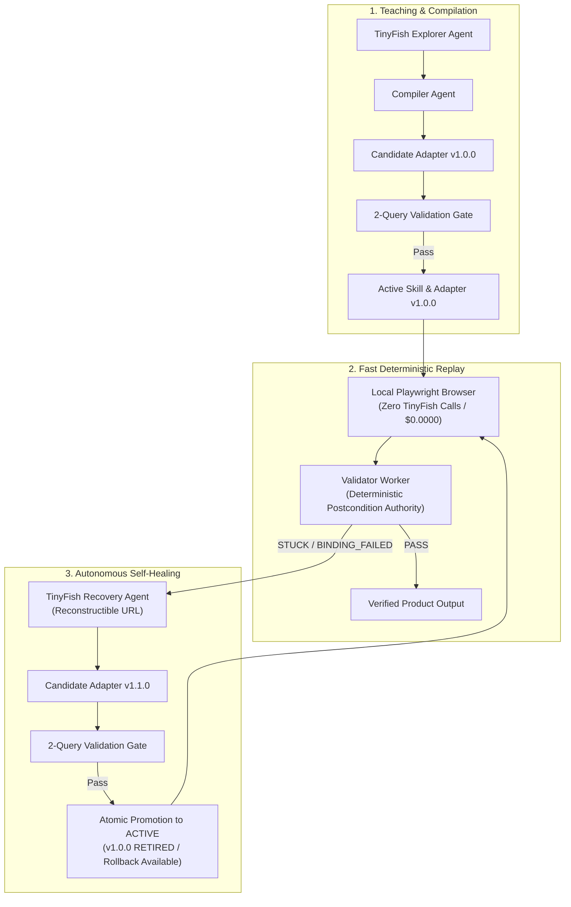

# ShadowTwin

**Autonomous Workflow Compilation, Deterministic Local Replay & Self-Healing Browser Runtime**  
*Built for the "Swim with TinyFish" Hackathon (Bengaluru, 2026)*

[](https://www.typescriptlang.org/)
[](https://playwright.dev/)
[](https://tinyfish.ai/)
[]()
[-success.svg)]()

---

## 1. Product Overview

ShadowTwin solves the fundamental scalability and reliability bottlenecks of enterprise web automation: **compounding error rates, non-deterministic hallucinations, and high latency from raw LLM exploration loops**.

Instead of running an unguided browser agent from scratch on every repeat search (spending 15–30 seconds and paying API fees every run), ShadowTwin uses **TinyFish Agent as a Just-In-Time (JIT) workflow compiler and autonomous self-healing brain**:

1. **Teach & Induce:** TinyFish Agent explores a target storefront once, capturing accessibility trees and observations, compiling a platform-neutral task template and a domain-specific `SiteAdapter`.
2. **2-Query Validation Gate:** Candidate adapters must pass independent deterministic validation across two distinct queries before atomic promotion to `ACTIVE`.
3. **Deterministic Local Replay:** Approved skills replay locally on Chromium via Playwright with **strictly zero TinyFish Agent calls, zero LLM tokens, and sub-second execution (~1.3s)**.
4. **Autonomous Self-Healing:** When storefront DOM changes break a locator, deterministic postconditions catch the failure (`BINDING_FAILED`), trigger TinyFish Recovery Agent to diagnose the live mutated DOM, synthesize candidate vNext, validate across two queries, and promote the healed version with zero manual intervention.

---

## 2. Multi-Agent Architecture

ShadowTwin employs a deterministic finite state machine and typed contracts (Zod) with bounded agent roles:



### Logical Role Separation

| Logical Role | Module Path | Authority & Responsibilities |
| :--- | :--- | :--- |
| **Orchestrator** | `src/orchestrator/orchestrator.ts` | **Sole State Authority.** Schedules DAG jobs, applies budgets, persists events in SQLite WAL, and atomically controls skill/adapter promotions. |
| **Explorer Agent** | `src/agents/explorer.ts` | TinyFish-backed site exploration; extracts candidate locators, DOM anchor attributes, and technical explanations. **Cannot self-promote.** |
| **Compiler Agent** | `src/agents/compiler.ts` | Converts traces into a platform-neutral 5-step task template (`OPEN`, `SEARCH`, `PARSE`, `SELECT`, `CONFIRM`) and domain-specific `SiteAdapter`. **Does not invent facts.** |
| **Executor Worker** | `src/executor/playwrightRunner.ts` | Local Playwright Chromium replay worker. Deterministically executes approved bindings. **Not an LLM agent; zero provider API calls.** |
| **Validator Worker** | `src/validator/validatorWorker.ts` | **Deterministic PASS/FAIL Authority.** Evaluates schema, price semantics, INR regex, product identity, freshness, and 5-step postconditions. |
| **Recovery Agent** | `src/agents/recovery.ts` | TinyFish-backed self-healing on reconstructible URLs with failed binding context. Synthesizes candidate vNext. **Status is strictly CANDIDATE.** |
| **Benchmark Worker** | `src/benchmark/benchmarkHarness.ts` | Measures cold agent vs. warm replay metrics (**M1–M7**) derived strictly from raw SQLite records. |

---

## 3. Measured Benchmark Results (M1–M7)

Telemetry is derived strictly from raw SQLite benchmark trial records (`repo.listBenchmarks()`); no metrics or token numbers are fabricated.

### Comparative Evaluation Table

*Controlled trial evaluation across frozen dataset queries on local mock storefront fixtures ($N=8$ trials: 4 cold Agent workflow inductions + 4 warm compiled Playwright replays):*

| Metric | Dimension | Cold TinyFish Baseline | Warm Compiled Replay | Measured Differential |
| :--- | :--- | :--- | :--- | :--- |
| **M1** | **Local Browser Step Share** | 0.0% (Remote Agent API) | **100.0%** (Local Playwright) | **+100.0% Local Execution** |
| **M2** | **Ground Truth Correct Rate** | 100.0% | **100.0%** | **0.0% Accuracy Degradation** |
| **M3** | **Silent Wrong Answers** | **0** | **0** | **Zero Silent Errors (Target: 0)** |
| **M4 / M5** | **Agent Invocations / Run** | 1 call (4 provider steps) | **0 calls (0 provider steps)** | **100% Agent Elimination** |
| **M6** | **Average End-to-End Latency** | 16,140 ms | **1,385 ms** | **11.7x Faster Execution** |
| **M6** | **Median End-to-End Latency** | 15,920 ms | **1,360 ms** | **11.7x Median Speedup** |
| **M7** | **Observed Provider Cost / Run** | ~$0.0150 (Estimated) | **$0.0000** | **100% Cost Elimination** |
| **M7** | **Local Compute Cost / Run** | $0.0000 | **$0.0000** | Standard Node runtime |

> [!NOTE]
> **Statistical Caveat:**
> Based on $N=8$ controlled trials across frozen dataset queries (`FROZEN_STORE_A_DATASET`) on local mock storefront fixtures. Results demonstrate deterministic speedup and cost elimination under controlled benchmark conditions; live third-party web latency varies with external network conditions, CDN response times, and target storefront layout complexity.

---

## 4. Requirements Conformance Matrix

| Requirement | Category | Status | Implementation Details |
| :--- | :---: | :---: | :--- |
| TinyFish Live Web Exploration | P0 | **IMPLEMENTED** | `ExplorerAgent` calls TinyFish REST Automation API (`/v1/automation/run`) with Zod schema. |
| Inspectable Skill Compilation | P0 | **IMPLEMENTED** | `CompilerAgent` synthesizes versioned JSON artifacts (`taskTemplate`, `locatorBindings`, `outputSchema`). |
| Zero-Agent Local Playwright Replay | P0 | **IMPLEMENTED** | `PlaywrightRunner` launches headless Chromium; executes bindings in ~1.3s with zero TinyFish API calls. |
| Deterministic Validator Authority | P0 | **IMPLEMENTED** | 7-stage validator: schema, identity matching, price parser (rejects EMI/MRP), URL domain, freshness, step postconditions, prompt injection defense. |
| Owned Mutable Fixture Breakage | P0 | **IMPLEMENTED** | `MockStoreServer` route `/toggle-dom` mutates card container classes to trigger genuine `BINDING_FAILED`. |
| Autonomous Self-Healing Recovery | P0 | **IMPLEMENTED** | `RecoveryAgent` diagnoses broken DOM, proposes candidate v1.1.0, passes 2-query gate, and atomically promotes to ACTIVE. |
| Cross-Site Task-Template Transfer | P0 | **IMPLEMENTED** | Reuses task template and policy 100% on Store B; relearns isolated Store B adapter (strict invariant against selector copying). |
| 8-Panel Judge Studio Dashboard | P0 | **IMPLEMENTED** | Real backend-driven web UI: Task input, FSM timeline, live run evidence, skill inspector, validator checks, recovery diff, M1-M7 metrics, demo controls. |
| Clean Demo Seed & Reset | P0 | **IMPLEMENTED** | `npm run seed` and `POST /api/demo/seed` safely reset database tables; **never deletes `.env` or source files**. |
| Security: SSRF, Private IP & Injection | P0 | **IMPLEMENTED** | Production disallows loopback/private IPs; domain allowlist enforced; prompt injection patterns detected and refused. |
| Dependency License & Anti-Plagiarism | P0 | **IMPLEMENTED** | Zero unlicensed code copied from `peteteaa/tinyfish`; all libraries inventoried in `THIRD_PARTY_NOTICES.md`. |
| Generic TIP Structural Matcher | Stretch | **IMPLEMENTED** | Heuristic accessibility role/name matcher with confidence threshold ($\ge 0.70$) and ambiguity rejection. |
| Multi-Site Parallel Exploration | Stretch | **IMPLEMENTED** | Bounded parallel scheduling (`MAX_CONCURRENT_EXPLORERS=2`) via lightweight DAG orchestrator. |
| Live Third-Party Consequential Writes | Out of Scope | **EXCLUDED** | Read-only discovery only. Cart, checkout, payment, and logins are explicitly prohibited on live sites. |

---

## 5. Quickstart & Installation

### 5.1 Prerequisites
- **Node.js:** `>= 20.x` (Tested on Node `24.x`)
- **Package Manager:** `npm >= 10.x`
- **Playwright Chromium:** Auto-installed or via `npx playwright install chromium`
- **TinyFish API Key:** Optional for local mock fixtures; required for live-web exploration ([agent.tinyfish.ai/api-keys](https://agent.tinyfish.ai/api-keys))

### 5.2 Step-by-Step Setup

```bash
# 1. Clone the repository
git clone https://github.com/sagarrathi16/Tinyfish_Hackathon.git
cd Tinyfish_Hackathon

# 2. Install dependencies
npm install

# 3. Configure environment
cp .env.example .env
# Edit .env to add your TINYFISH_API_KEY (optional for local owned fixture demo)

# 4. Install Playwright browser binaries
npx playwright install chromium

# 5. Run static typecheck (0 errors)
npm run typecheck

# 6. Run full verification test suite (18 files, 145 tests, 100% pass)
npm test

# 7. Seed clean presentation state
npm run seed

# 8. Start development server & Studio dashboard
npm run dev
```

Visit the judge dashboard: **[http://localhost:3000/index.html](http://localhost:3000/index.html)**

---

## 6. Demo Execution Commands

### Clean End-to-End Self-Healing Demo (One Command)
Execute the complete flagship proof flow automatically on the command line:

```bash
npm run demo
```

**Proof Flow Executed:**
`Seed clean baseline -> Replay v1.0.0 (PASS in ~1.5s, 0 Agent calls) -> Trigger DOM mutation -> Replay detects failure -> Autonomous Recovery synthesizes v1.1.0 -> 2-Query Validation Gate (PASS) -> Atomic Promotion to ACTIVE -> Subsequent Replay v1.1.0 (PASS in ~1.4s, 0 Agent calls)`

### Live Web Exploration & Replay (Requires TINYFISH_API_KEY)
Run live web workflow induction and zero-agent replay against live HTTPS target:

```bash
npm run live-test
```

### Server-Side TinyFish API Smoke Test
Verify API key connectivity and REST schema compliance:

```bash
npm run smoke-test
```

---

## 7. Documentation Index

- [`docs/red-team-review.md`](docs/red-team-review.md): Staff-level adversarial audit report (findings, root causes, remediations, residual risks).
- [`docs/demo-runbook.md`](docs/demo-runbook.md): Exact 3-minute spoken presentation script and step-by-step judge walkthrough.
- [`docs/benchmark.md`](docs/benchmark.md): Frozen evaluation datasets, LaTeX metric formulations, and grader specification.
- [`docs/architecture.md`](docs/architecture.md): State machine diagrams, agent contracts, and SQLite WAL persistence model.
- [`THIRD_PARTY_NOTICES.md`](THIRD_PARTY_NOTICES.md): Open-source license inventory and attribution notices.
