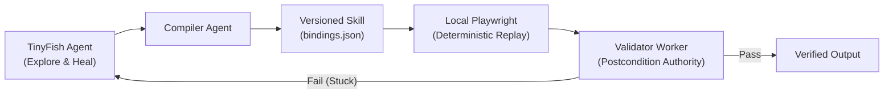

# ShadowTwin

**Autonomous Workflow Compilation, Deterministic Replay & Live Self-Healing Runtime**  
*Built for the "Swim with TinyFish" Hackathon (Bengaluru, 2026)*

---

## 1. Product Overview

ShadowTwin solves the #1 reliability failure in enterprise web agents: **compounding error rates and high latency from raw LLM exploration loops**.

Instead of running an unguided LLM agent from scratch 10,000 times on repeated tasks, ShadowTwin uses **TinyFish Agent as a Just-In-Time (JIT) workflow compiler and autonomous self-healing brain**:
1. **Teach & Induce:** TinyFish Agent explores live websites, inducing a versioned skill (task template + site-specific bindings).
2. **Deterministic Replay:** Validated steps run locally via Playwright with **zero TinyFish Agent calls, zero LLM tokens, and sub-second execution**.
3. **Autonomous Self-Healing:** When a website layout shifts, strict deterministic postconditions catch the break (`BINDING_FAILED`), trigger TinyFish Agent to diagnose and synthesize `binding_v2`, test it on two queries, and restore deterministic execution live on stage.

---

## 2. Multi-Agent Architecture



| Logical Role | Module | Mechanism |
| :--- | :--- | :--- |
| **Orchestrator** | `src/orchestrator/` | Deterministic finite state machine, scheduler, and version promotion authority. |
| **Explorer Agent** | `src/agents/explorer.ts` | Calls TinyFish Automation API (`/v1/automation/run`) to observe and teach workflows. |
| **Compiler Agent** | `src/agents/compiler.ts` | Compiles traces into platform-neutral templates and site adapters. |
| **Executor Worker** | `src/executor/playwrightRunner.ts` | Standalone local Playwright instance for zero-token deterministic replay. |
| **Validator Worker** | `src/validator/` | Deterministic schema, INR currency regex, identity, and step postcondition checks. |
| **Recovery Agent** | `src/agents/recovery.ts` | TinyFish Agent on reconstructible URLs proposing candidate replacement bindings. |
| **Benchmark Worker** | `src/benchmark/` | Measures raw-agent vs. compiled-replay latency, API spend, and accuracy. |

---

## 3. Quickstart & Local Setup

### 3.1 Prerequisites
* Node.js `24.x` or higher
* npm `11.x` or higher
* TinyFish API Key ([agent.tinyfish.ai/api-keys](https://agent.tinyfish.ai/api-keys))

### 3.2 Installation
```bash
# Clone the repository
git clone https://github.com/sagarrathi16/Tinyfish_Hackathon.git
cd Tinyfish_Hackathon

# Install dependencies
npm install

# Copy environment template
cp .env.example .env
```

### 3.3 Environment Variables
Configure your `.env` file according to `.env.example`:

| Variable | Requirement | Default | Description |
| :--- | :---: | :---: | :--- |
| **`TINYFISH_API_KEY`** | **REQUIRED** | *none* | TinyFish API key for Explorer and Recovery agents |
| `NODE_ENV` | Optional | `development` | Runtime mode (`development`, `test`, `production`) |
| `PORT` | Optional | `3000` | Port for local server & studio dashboard |
| `LOG_LEVEL` | Optional | `info` | Logging verbosity (`debug`, `info`, `warn`, `error`) |
| `ALLOWED_TARGET_DOMAINS` | Optional | `robu.in,books.toscrape.com...` | Permitted domains for SSRF protection |
| `MAX_CONCURRENT_EXPLORERS` | Optional | `2` | Bounded concurrency for live site explorers |
| `MAX_AGENT_RUNS_PER_JOB` | Optional | `4` | Maximum agent invocations permitted per task |
| `JOB_TIMEOUT_SECONDS` | Optional | `300` | Timeout threshold for workflow jobs |

### 3.4 Running the Application
```bash
# Run unit tests
npm test

# Run static typechecking
npm run typecheck

# Start development server
npm run dev
```

Visit `http://localhost:3000/health` or open `http://localhost:3000` in your browser for the Studio dashboard.

---

## 4. Security & Safety Guardrails
* **Server-Only Configuration:** All API credentials are parsed server-side at startup. Secrets are never exposed to frontend bundles (`NEXT_PUBLIC_` or `VITE_` forbidden).
* **Automated Redaction:** All structured logs automatically redact tokens, authorization headers, and cookies.
* **Read-Only on Live Sites:** Live third-party sites are strictly read-only. All destructive or DOM-mutation tests run on an owned local fixture.
* **SSRF Protection:** Navigation boundaries strictly block private IP ranges, localhost (except for fixture tests), and cloud metadata endpoints.
